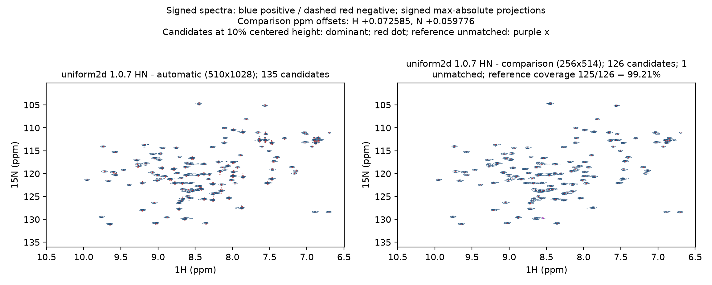
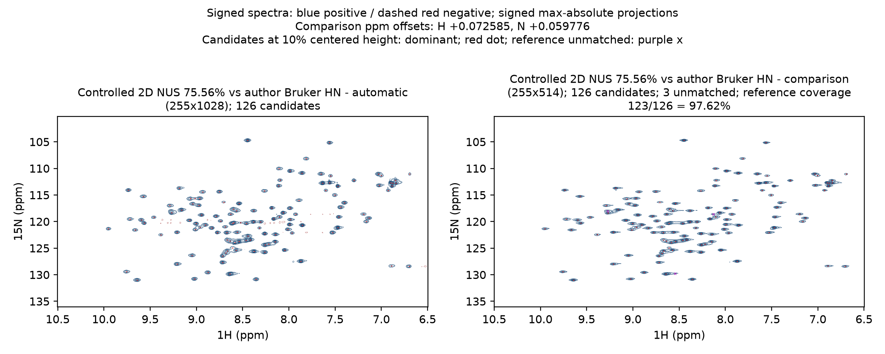
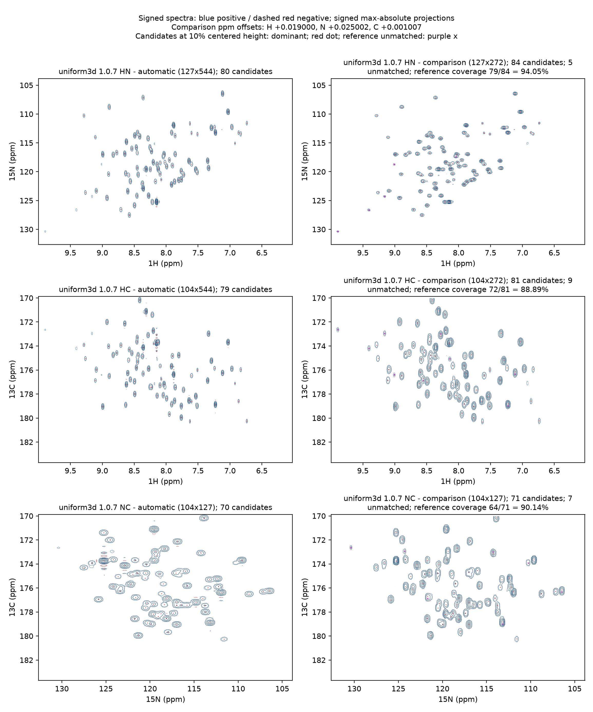
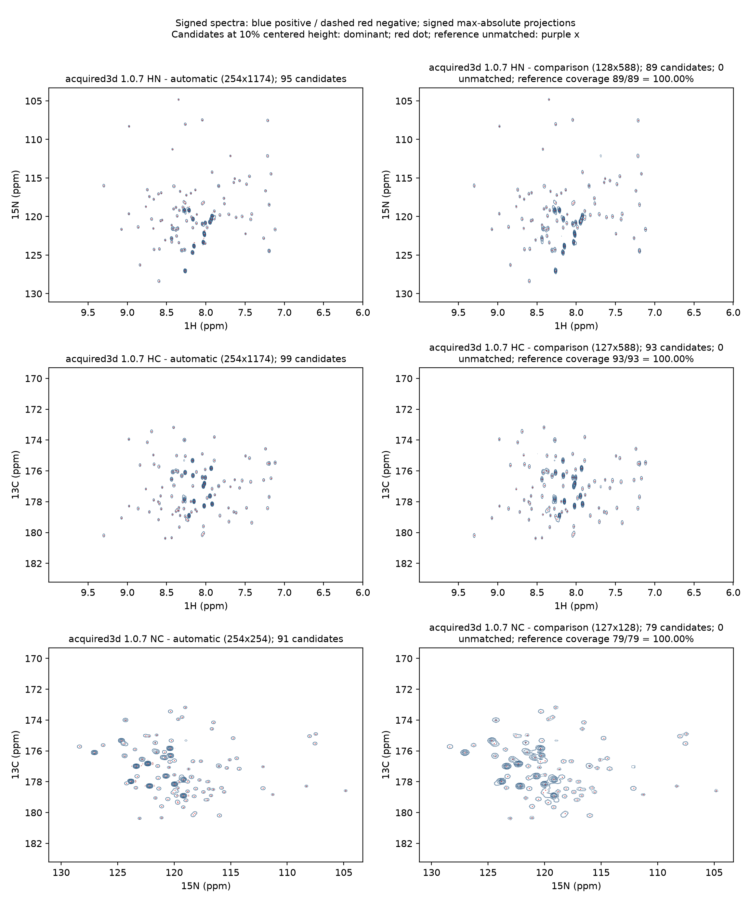

# 四条处理路径：二维谱与三维投影对照

本页展示软件1.0.7 / API v1.1.3按照最新数据处理流程得到的终谱，四组均于2026-10-14从原始数据重新处理、统计与出图。
四组均与作者提供的处理谱或原样作者脚本重建谱对照，采用自动流程生成最终相位与处理参数。

## 如何读图

左为NMRForge，右为参考。蓝实线为正信号，红虚线为负信号；两侧等高线从各自最大绝对强度7.5%开始。
7.5%和10%两条线0.25 pt，其余0.4 pt；普通候选为红色小点（marker='.'、s=4、无描边），仅参考未匹配候选为紫色x。
3D先裁共同完整三维窗口，再分别生成HN、HC、NC有符号最大绝对值投影，逐投影独立检测与匹配。
同号HSQC/HNCO使用dominant；检测为各谱中位基线中心化后最大绝对峰高的10%，不与内部窗评分12/6σ混用。

**匹配率＝匹配对数/参考候选数**。两侧按相同10%阈值独立选峰，再进行同号一对一匹配。
重叠峰、强峰旁瓣和阈值附近的弱结构会影响候选个数；每组图下说明具体原因及对应局部信号。
负瓣保留为红色虚线展示，主符号dominant规则使匹配集中于HSQC/HNCO的主信号。
两谱各自归一显示，并按记录的来源统一整轴谱中心，峰间相对位置保持。

## 数据与参考

| 路径 | 输入 | 参考 |
| --- | --- | --- |
| 2D uniform | BMRB27493，Apo_CBL_0.4mM/2，90复增量 | 作者Bruker pdata/1 |
| 受控2D NUS | 同一uniform原始数据；请求75%，68/90＝75.56%，seed20261008 | 作者Bruker pdata/1 |
| 3D uniform | BMRB15750 HNCO；32×32完整复网格 | 同一原始数据原样执行作者fid.com/proc.com重建的完整3D |
| 实采3D NUS | BMRB52533 HNCO；441/(42×42)＝25% | 沉积DomainIV_HNCO.ft3 |

来源：[BMRB27493](https://bmrb.io/data_library/summary/?bmrbId=27493)、
[BMRB15750](https://bmrb.io/data_library/summary/?bmrbId=15750)、[BMRB52533](https://bmrb.io/data_library/summary/?bmrbId=52533)。
人工2D NUS由uniform原始数据受控下采样生成，直接与同源作者Bruker终谱对照。
15750原样执行作者处理脚本获得完整3D参考；52533读取作者沉积的完整3D终谱。

## 结果概览与自动处理优势

四组谱图的主要信号位置与作者处理结果对应良好。逐处查看未匹配位置后，可见差异来自强峰旁瓣被单独选中、
重叠峰难以一对一拆分，以及弱峰低于统一检出阈值；对应局部信号仍保留。
作者针对具体实验增加LP和专用窗处理，改善部分弱峰和峰宽；通用自动流程在不同处理方案下仍得到良好谱图，体现了软件的可靠性。

- **独立自动处理得到一致谱结构。** 从原始Bruker数据自动解析、相位/窗/基线优化到完整终跑，
  未抄用作者最终相位或实验专用LP/窗方案，四条路径均得到与作者对应的主要信号，两个NUS案例也成功重构。
- **自动相位接近作者。** 52533按联合符号等价比较后H/N/C残差为0.969°/2.50°/0°；
  15750 N/C各2.50°，H在约8 ppm处与作者带P1相位曲线相差3.61°。自动结果在主要信号区域接近作者手工设置。
- **采集编码判断正确。** Echo–AntiEcho二维按其实际编码转换；15750碳维FT使用`-alt`；
  52533 N维`-alt -neg`、C维`-alt`及SMILE编码与作者一致，轴向与整体符号正确。
- **谱宽冲突自动解析正确。** 15750碳维SW_h与SW×SFO1不一致，软件按通用规则解析为3636.364 Hz，
  与作者转换采用值一致；原始参数、冲突原因和最终采用值均有记录。
- **分辨率差异有明确处理原因。** 作者15750在两个间接维加入LP。保持其余作者命令不变、关闭两处LP后，
  N维局部峰宽约增至1.94倍，C维约1.22倍；作者较窄的N维峰形来自额外的针对性处理。

## 2D uniform：与作者Bruker谱比较



本谱135个、作者126个候选，匹配125对（99.21%）。**唯一未匹配项是作者强峰旁的一处较强正旁瓣被单独选成候选**
（H约8.544、N约129.748 ppm）；自动谱中保留了这段肩部/旁瓣结构，未将它再单列为独立峰。
因此这一项反映候选拆分方式的差异，主体信号保持一致。自动N维采用GM4/8 Hz，与作者不同的窗仍得到良好对应。
作者整轴平移H +0.072584594、N +0.059775701 ppm，使用已冻结强峰锚点统一参照。

| 投影 | 本谱 / 参考候选 | 匹配 / 参考候选 | 中位绝对位置差(ppm) |
| --- | --- | --- | --- |
| HN | 135 / 126 | 125/126＝99.21% | H 0.00049；N 0.00759 |

匹配候选的局部等效线宽本谱/参考中位比：HN H 0.94 / N 0.92。按匹配候选的局部半高宽估计。

自动完整构建用时33.102 s，终谱512×1028。

[比较统计与未匹配坐标](2d-uniform-author-comparison_20261014.json)；[局部响应核验](local-response-audit_20261014.json)。

### 本组处理脚本 / 参数对比

自动列为本次实际终跑；下表逻辑轴配置按Bruker核名标识。未选中的轴沿用正常处理默认，实际命令以下方完整脚本为准。

| 核 / 逻辑轴 | 本次明确采用的窗配置 |
| --- | --- |
| 1H / F2 | `{"c": 0.5, "end": 0.98, "off": 0.45, "pow": 2, "type": "sine_bell"}` |
| 15N / F1 | `{"c": 1.0, "g1": 4.0, "g2": 8.0, "g3": 0.0, "type": "gaussian"}` |

作者参考为同目录Bruker `pdata/1`；WDW=4、SSB=2、LB=GB=0，H/N的SI为2048/256。
作者Bruker相位按原始PHC约定列出，二维相位效果通过最终峰形及整体符号对照。

<details>
<summary>展开本组实际自动转换与终处理脚本</summary>

**自动转换**

```csh
#!/bin/csh

bruk2pipe -verb -in ./ser \
  -bad 0.0 -ext -aswap -AMX -decim 2088 -dspfvs 20 -grpdly 67.9876556396484  \
  -xN              2048  -yN               180  \
  -xT              1024  -yT                90  \
  -xMODE            DQD  -yMODE  Echo-AntiEcho  \
  -xSW         9578.544  -ySW         2187.227  \
  -xOBS         599.503  -yOBS          60.754  \
  -xCAR           4.771  -yCAR         118.077  \
  -xLAB 1H  -yLAB             15N  \
  -ndim               2  -aq2D         Complex  \
| nmrPipe -fn MULT -c 9.76562e-01 \
  -out ./d_001.fid -ov
```

**自动终处理**

```csh
#!/bin/csh
# NMRForge processing script
# experiment: d_001
xyz2pipe -in d_001.fid -x \
| nmrPipe -fn POLY -time \
| nmrPipe -fn SP -off 0.45 -end 0.98 -pow 2 -c 0.5 \
| nmrPipe -fn ZF -size 4096 \
| nmrPipe -fn FT \
| nmrPipe -fn PS -p0 0 -p1 0 -di \
| nmrPipe -fn POLY -ord 3 -auto \
| nmrPipe -fn EXT -x1 10.5ppm -xn 6.5ppm -sw -round 2 \
| nmrPipe -fn TP \
| nmrPipe -fn GM -g1 4 -g2 8 \
| nmrPipe -fn ZF -size 512 \
| nmrPipe -fn FT \
| nmrPipe -fn PS -p0 265 -p1 0 -di \
| nmrPipe -fn POLY -ord 3 -auto \
| nmrPipe -fn TP \
| pipe2xyz -out d_001.ft2 -x
```

</details>

<details>
<summary>展开作者沉积参数或脚本</summary>

**procs**

```text
##$BC_mod= 6
##$GB= 0
##$LB= 0
##$OFFSET= 12.68878
##$PHC0= 7.599999
##$PHC1= 0
##$SF= 599.5
##$SI= 2048
##$SSB= 2
##$SW_p= 9578.54406130266
##$WDW= 4
```

**proc2s**

```text
##$BC_mod= 0
##$GB= 0
##$LB= 0
##$OFFSET= 136.0028
##$PHC0= -2.4
##$PHC1= 0
##$SF= 60.74680744
##$SI= 256
##$SSB= 2
##$SW_p= 2187.22659667541
##$WDW= 4
```

</details>

## 受控人工2D NUS：请求75%，实际75.56%



调用vm_make_evidence_nus.py重新生成输入：保留完整正交增量，90点取68点，含零及末端增量，实际75.56%。
新输入经重新导入、转换与完整SMILE终跑，直接对照作者Bruker `pdata/1`；H窗口10.5～6.5 ppm。
采用与2D uniform同一作者参照偏移：H +0.072584594、N +0.059775701 ppm。

本谱126个、作者126个候选，匹配123对（97.62%）。**三个未匹配位置均可见对应局部信号：**

- H约9.275、N约118.058 ppm：作者分开检出的近邻峰在自动NUS谱中重叠为一个较宽极大值，故一对一匹配少计一项。
- H约8.131、N约118.612 ppm：弱肩峰仍可见，局部峰高约为本谱最大峰的8.15%，低于统一10%检出阈值。
- H约8.544、N约129.748 ppm：与uniform组相同的作者强峰旁瓣，自动谱局部响应约9.18%，未单独进入10%候选表。

在只保留75.56%增量的条件下，自动NUS重构仍保留了与作者uniform谱对应的主体结构和这些局部弱信号。

| 投影 | 本谱 / 参考候选 | 匹配 / 参考候选 | 中位绝对位置差(ppm) |
| --- | --- | --- | --- |
| HN | 126 / 126 | 123/126＝97.62% | H 0.00125；N 0.00738 |

匹配候选的局部等效线宽本谱/参考中位比：HN H 0.86 / N 1.37。按匹配候选的局部半高宽估计。

自动完整构建用时17.066 s，终谱256×1028。

[比较统计与未匹配坐标](controlled-2d-nus75-comparison_20261014.json)；[局部响应核验](local-response-audit_20261014.json)。

### 本组处理脚本 / 参数对比

自动列为本次实际终跑；下表逻辑轴配置按Bruker核名标识。未选中的轴沿用正常处理默认，实际命令以下方完整脚本为准。

| 核 / 逻辑轴 | 本次明确采用的窗配置 |
| --- | --- |
| 1H / F2 | `NUS直接维固定SP .45/.98/pow2/c.5` |
| 15N / F1 | `{"c": 1.0, "lb": 5.0, "type": "exp"}` |

参考为作者Bruker `pdata/1`，其WDW=4、SSB=2、LB=GB=0，H/N的SI为2048/256；作者原始处理参数见本节末尾。
自动NUS直接维采用固定SP .45/.98/pow2/c.5，间接维采用自动评分选出的EM5 Hz。

<details>
<summary>展开本组实际自动转换与终处理脚本</summary>

**自动转换**

```csh
#!/bin/csh

nusExpand.tcl -yT 90 -mode bruker -sampleCount 68 -avg -off 0 \
 -in ./ser -out ./ser_full -sample ./nuslist

bruk2pipe -verb -in ./ser_full \
  -bad 0.0 -ext -aswap -AMX -decim 2088 -dspfvs 20 -grpdly 67.9876556396484  \
  -xN              2048  -yN               180  \
  -xT              1024  -yT                90  \
  -xMODE            DQD  -yMODE  Echo-AntiEcho  \
  -xSW         9578.544  -ySW         2187.227  \
  -xOBS         599.503  -yOBS          60.754  \
  -xCAR           4.771  -yCAR         118.077  \
  -xLAB 1H  -yLAB             15N  \
  -ndim               2  -aq2D         Complex  \
| nmrPipe -fn MULT -c 9.76562e-01 \
  -out ./d_001.fid -ov
```

**自动终处理**

```csh
#!/bin/csh
# NMRForge 2D NUS SMILE reconstruction (two-stage)
# experiment: d_001
mkdir -p nus2d
# stage 1: direct dim (F2) FT + EXT + POLY, SMILE reconstruct F1
nmrPipe -in d_001.fid \
| nmrPipe -fn POLY -time \
| nmrPipe -fn SP -off 0.45 -end 0.98 -pow 1 -c 0.5 \
| nmrPipe -fn ZF -zf -size 4096 \
| nmrPipe -fn FT \
| nmrPipe -fn EXT -x1 10.5ppm -xn 6.5ppm -sw -round 2 \
| nmrPipe -fn PS -p0 173.559 -p1 -0 -di \
| nmrPipe -fn POLY -ord 3 -auto \
| nmrPipe -fn TP \
| nmrPipe -fn SMILE -nDim 2 \
           -sample nuslist -nThread 2 \
           -sampleCount 68 -nSigma 5 -off 0 0 -report 1 \
           -maxMem 11.8195 \
           -scaling 1 \
           -maxIter 300 \
           -xT 90 \
           -xP0 85 -xP1 0 \
           -thresh 0.95 \
| pipe2xyz -out nus2d/recon.ft1 -x -ov

# stage 2: indirect dim (F1) window + ZF + FT -alt + PS + POLY
nmrPipe -in nus2d/recon.ft1 \
| nmrPipe -fn EM -lb 5 \
| nmrPipe -fn ZF -size 256 \
| nmrPipe -fn FT \
| nmrPipe -fn PS -p0 85 -p1 0 -di \
| nmrPipe -fn POLY -ord 2 -auto \
| nmrPipe -fn TP \
  -out d_001.ft2 -ov
```

</details>

<details>
<summary>展开作者沉积参数或脚本</summary>

**procs**

```text
##$BC_mod= 6
##$GB= 0
##$LB= 0
##$OFFSET= 12.68878
##$PHC0= 7.599999
##$PHC1= 0
##$SF= 599.5
##$SI= 2048
##$SSB= 2
##$SW_p= 9578.54406130266
##$WDW= 4
```

**proc2s**

```text
##$BC_mod= 0
##$GB= 0
##$LB= 0
##$OFFSET= 136.0028
##$PHC0= -2.4
##$PHC1= 0
##$SF= 60.74680744
##$SI= 256
##$SSB= 2
##$SW_p= 2187.22659667541
##$WDW= 4
```

</details>


## 3D uniform：BMRB15750与作者完整3D脚本重建谱



原始ser为16,777,216字节，与32×32完整复网格及正交分量相符；不是二维切片充当三维参考。
H/N/C参照平移分别+0.018999577、+0.025001526、+0.001007080 ppm，来自本轮同核谱头CAR差。
**未匹配位置仍有可对应信号。** 三个投影累计21处未匹配候选中，11处弱响应低于统一10%阈值，
8处已有近邻候选参加一对一匹配，另2处表现为肩峰或重叠结构而未单列。局部放大图均能看到对应正信号。
图中红色负瓣与正峰周围旁瓣也体现窗及截断处理的差异；主符号匹配聚焦正信号。

**N维峰宽差异来自作者额外的LP优化。** 作者在N、C间接维使用`LP -fb`及专用窗，N维尤其更窄、部分弱结构更容易独立检出。
为核对其作用，保留同一作者转换FID和全部其他处理命令，只关闭两处有效LP：
不加LP时N维局部峰宽约为加LP后的1.94倍，C维约1.22倍，H维约1.00倍。
这一直接对照解释了作者对具体实验追加处理后，在N维峰宽及弱峰展示上的优势。
自动流程采用不同方案，H/C维的匹配峰宽反而较窄，主体信号依然完整对应。

| 投影 | 本谱 / 参考候选 | 匹配 / 参考候选 | 中位绝对位置差(ppm) |
| --- | --- | --- | --- |
| HN | 80 / 84 | 79/84＝94.05% | H 0.00088；N 0.01671 |
| HC | 79 / 81 | 72/81＝88.89% | H 0.00082；C 0.03183 |
| NC | 70 / 71 | 64/71＝90.14% | N 0.01873；C 0.03074 |

匹配候选的局部等效线宽本谱/参考中位比：HN H 0.67 / N 1.57；HC H 0.68 / C 0.75；NC N 1.59 / C 0.72。按匹配候选的局部半高宽估计。

自动完整构建用时52.337 s，终谱128×128×548。

[作者LP开关对照统计](author-lp-comparison_20261014.json)保留相同作者命令下的峰宽变化。

<details>
<summary>展开作者保留LP / 关闭LP的三投影对照</summary>

左为只关闭两处LP，右为原样作者脚本，其余处理步骤相同。


</details>

[比较统计与未匹配坐标](3d-uniform-bmrb15750-comparison_20261014.json)；[局部响应核验](local-response-audit_20261014.json)。

### 本组处理脚本 / 参数对比

自动列为本次实际终跑；下表逻辑轴配置按Bruker核名标识。未选中的轴沿用正常处理默认，实际命令以下方完整脚本为准。

| 核 / 逻辑轴 | 本次明确采用的窗配置 |
| --- | --- |
| 1H / F3 | `{"c": 1.0, "g1": 4.0, "g2": 8.0, "g3": 0.0, "type": "gaussian"}` |
| 15N / F2 | `沿用正常默认；见实际脚本` |
| 13C / F1 | `{"type": "none"}` |

作者使用H维SP及两次PS（3°/0°、−4°/43°），含间接维LP与实验专用窗处理；
本软件从原始Bruker独立转换并自动相位/窗/基线优化，采用通用自动流程得到与作者对应的主谱结构。
碳维SW_h与SW×SFO1冲突，采用3636.364 Hz，与作者转换一致；不是本数据专用特例。

<details>
<summary>展开本组实际自动转换与终处理脚本</summary>

**自动转换**

```csh
#!/bin/csh

bruk2pipe -verb -in ./ser \
  -bad 0.0 -ext -aswap -AMX -decim 1568 -dspfvs 20 -grpdly 67.9841461181641  \
  -xN              1024  -yN                64  -zN                64  \
  -xT               512  -yT                32  -zT                32  \
  -xMODE            DQD  -yMODE Echo-AntiEcho  -zMODE States-TPPI  \
  -xSW        12755.102  -ySW         2500.000  -zSW 3636.364  \
  -xOBS         850.104  -yOBS          86.150  -zOBS         213.795  \
  -xCAR           4.819  -yCAR         118.125  -zCAR         178.251  \
  -xLAB 1H  -yLAB             15N  -zLAB             13C  \
  -ndim               3  -aq2D         Complex                         \
| nmrPipe -fn MULT -c 1.95312e+00 \
| pipe2xyz -x -out ./fid/test%03d.fid -ov
```

**自动终处理**

```csh
#!/bin/csh
# NMRForge processing script
# experiment: d_001
xyz2pipe -in fid/test%03d.fid -x \
| nmrPipe -fn POLY -time \
| nmrPipe -fn GM -g1 4 -g2 8 \
| nmrPipe -fn ZF -size 2048 \
| nmrPipe -fn FT \
| nmrPipe -fn PS -p0 15 -p1 0 -di \
| nmrPipe -fn EXT -x1 10ppm -xn 6ppm -sw -round 2 \
| nmrPipe -fn TP \
| nmrPipe -fn SP -off 0.45 -end 0.95 -pow 1 -c 0.5 \
| nmrPipe -fn ZF -size 128 \
| nmrPipe -fn FT \
| nmrPipe -fn PS -p0 267.5 -p1 0 -di \
| nmrPipe -fn ZTP \
| nmrPipe -fn ZF -size 128 \
| nmrPipe -fn FT -alt \
| nmrPipe -fn PS -p0 2.5 -p1 0 -di \
| nmrPipe -fn TP \
| pipe2xyz -out d_001.ft3 -x
```

</details>

<details>
<summary>展开作者沉积参数或脚本</summary>

**fid.com**

```csh
#!/bin/csh

bruk2pipe -in ./ser -bad 0.0 -aswap -DMX -decim 1568 -dspfvs 20 -grpdly 67.9841461181641  \
  -xN              1024  -yN                64  -zN                64  \
  -xT               512  -yT                32  -zT                32  \
  -xMODE            DQD  -yMODE  Echo-AntiEcho  -zMODE    States-TPPI  \
  -xSW        12755.102  -ySW         2500.000  -zSW         3636.364  \
  -xOBS         850.104  -yOBS          86.150  -zOBS         213.795  \
  -xCAR           4.800  -yCAR         118.100  -zCAR         178.250  \
  -xLAB              H1  -yLAB             N15  -zLAB             C13  \
  -ndim               3  -aq2D          States                         \
  -out ./data/test%03d.fid -verb -ov

sleep 5
```

**proc.com**

```csh
#!/bin/csh

xyz2pipe -in  data/test%03d.fid -x  -verb           \
| nmrPipe  -fn POLY -time                           \
| nmrPipe  -fn SP -size 512 -off 0.5 -end 1.00 -pow 2 -c 0.5  \
| nmrPipe  -fn ZF -auto                             \
| nmrPipe  -fn FT                                   \
| nmrPipe  -fn PS -p0  3.0 -p1 0                    \
| nmrPipe  -fn PS -p0 -4  -p1 43.0 -di               \
| nmrPipe  -fn EXT -x1 10.0ppm -xn 6.0ppm -sw       \
| pipe2xyz -out data/test%03d.ft3 -x -ov

xyz2pipe -in data/test%03d.ft3 -z -verb               \
| nmrPipe  -fn SP -off 0.5 -end 0.98 -pow 1 -c 0.5  \
| nmrPipe  -fn ZF -auto                             \
| nmrPipe  -fn FT -alt                              \
| nmrPipe  -fn PS -p0 0.0 -p1 0.0 -di               \
| pipe2xyz -out data/test%03d.ft3 -z -inPlace

xyz2pipe -in data/test%03d.ft3 -y -verb               \
| nmrPipe  -fn LP -fb                               \
| nmrPipe  -fn SP -off 0.5 -end 0.98 -pow 1 -c 1.0  \
| nmrPipe  -fn ZF -auto                             \
| nmrPipe  -fn FT                                   \
| nmrPipe  -fn PS -p0 -90 -p1 0 -di                   \
| nmrPipe  -fn POLY -auto -ord 0                    \
| nmrPipe  -fn TP                                   \
| nmrPipe  -fn POLY -auto -ord 0                    \
| pipe2xyz -out data/test%03d.ft3 -y -inPlace

xyz2pipe -in data/test%03d.ft3 -z -verb               \
| nmrPipe  -fn HT  -auto                            \
| nmrPipe  -fn PS  -inv -hdr                        \
| nmrPipe  -fn FT  -inv                             \
| nmrPipe  -fn ZF  -inv                             \
#| nmrPipe  -fn LP -pred 32 -ord 8                   \
| nmrPipe  -fn LP -fb                               \
| nmrPipe  -fn SP  -hdr                             \
| nmrPipe  -fn ZF  -auto                            \
| nmrPipe  -fn FT                                   \
| nmrPipe  -fn PS  -hdr -di                         \
| nmrPipe  -fn CS  -ls 3.0ppm   -sw                   \
| nmrPipe  -fn POLY -auto -ord 0                    \
| pipe2xyz -out data/test%03d.ft3 -z -inPlace

xyz2pipe -in ./data/test%03d.ft3  -y -verb  \
  > ./hnco.ft3
```

</details>

## 实采3D NUS：BMRB52533与沉积完整终谱比较



实采441点、42×42复网格、25%采样；输入ser/nuslist哈希保持。三个投影参考候选均匹配，未额外平移。
**本组没有未匹配的参考候选：HN、HC、NC三个投影分别达到89/89、93/93、79/79。**
自动流程在25%实采数据上完成SMILE重构，主要信号位置、相位及整体符号与作者完整3D终谱对应良好。

| 投影 | 本谱 / 参考候选 | 匹配 / 参考候选 | 中位绝对位置差(ppm) |
| --- | --- | --- | --- |
| HN | 95 / 89 | 89/89＝100.00% | H 0.00033；N 0.00946 |
| HC | 99 / 93 | 93/93＝100.00% | H 0.00029；C 0.00317 |
| NC | 91 / 79 | 79/79＝100.00% | N 0.01006；C 0.00335 |

匹配候选的局部等效线宽本谱/参考中位比：HN H 0.95 / N 0.76；HC H 0.94 / C 0.78；NC N 0.75 / C 0.77。按匹配候选的局部半高宽估计。

自动完整构建用时235.346 s，终谱256×256×1176。

[比较统计与未匹配坐标](acquired-3d-bmrb52533-comparison_20261014.json)；[局部响应核验](local-response-audit_20261014.json)。

### 本组处理脚本 / 参数对比

自动列为本次实际终跑；下表逻辑轴配置按Bruker核名标识。未选中的轴沿用正常处理默认，实际命令以下方完整脚本为准。

| 核 / 逻辑轴 | 本次明确采用的窗配置 |
| --- | --- |
| 1H / F3 | `NUS直接维固定SP .45/.98/pow2/c.5` |
| 15N / F2 | `{"c": 1.0, "g1": 4.0, "g2": 8.0, "g3": 0.0, "type": "gaussian"}` |
| 13C / F1 | `{"type": "none"}` |

参考直接读取沉积`DomainIV_HNCO.ft3`；下列作者`conv_smile.com`用于方法对照，未执行或改写该沉积谱。
两侧SMILE/FT编码可对照；自动间接相位传入SMILE并与最终PS一致，未逐峰对齐。

<details>
<summary>展开本组实际自动转换与终处理脚本</summary>

**自动转换**

```csh
#!/bin/csh

nusExpand.tcl -zT 42 -yT 42 -mode bruker -sampleCount 441 -avg -off 0 \
 -in ./ser -out ./ser_full -sample ./nuslist

bruk2pipe -verb -in ./ser_full \
  -bad 0.0 -ext -aswap -AMX -decim 1792 -dspfvs 20 -grpdly 67.9841766357422  \
  -xN              2048  -yN                84  -zN                84  \
  -xT              1024  -yT                42  -zT                42  \
  -xMODE            DQD  -yMODE States-TPPI  -zMODE States-TPPI  \
  -xSW        11160.714  -ySW         2269.632  -zSW         2816.901  \
  -xOBS         799.864  -yOBS          81.059  -zOBS         201.160  \
  -xCAR           4.773  -yCAR         117.084  -zCAR         176.207  \
  -xLAB 1H  -yLAB             15N  -zLAB             13C  \
  -ndim               3  -aq2D         Complex  \
| nmrPipe -fn MULT -c 1.95312e+00 \
  -out ./d_001.fid -ov
```

**自动终处理**

```csh
#!/bin/csh
# NMRForge 3D NUS SMILE reconstruction
# experiment: d_001
mkdir -p nus3d_1 nus3d_rc
# step 1: direct dim (F3) FT + EXT + PS
xyz2pipe -in d_001.fid -x \
| nmrPipe -fn SP -off 0.45 -end 0.98 -pow 2 -c 0.5 \
| nmrPipe -fn ZF -zf -size 4096 \
| nmrPipe -fn FT \
| nmrPipe -fn EXT -x1 10ppm -xn 6ppm -sw -round 2 \
| nmrPipe -fn PS -p0 107.969 -p1 -0 -di \
| pipe2xyz -out nus3d_1/test%04d.ft1 -z

# step 2: SMILE reconstruct indirect dims (F2/F1)
xyz2pipe -in nus3d_1/test%04d.ft1 -x \
| nmrPipe -fn SMILE -nDim 3 \
           -sample nuslist -nThread 2 \
           -sampleCount 441 -nSigma 5 -off 0 0 -report 1 \
           -maxMem 10.0464 \
           -scaling 1 \
           -maxIter 1500 \
           -xP0 182.5 -xP1 0 \
           -yP0 0 -yP1 0 \
           -xAlt -xNeg \
           -yAlt \
           -thresh 0.95 \
| pipe2xyz -out nus3d_rc/test%04d.ft1 -x

# step 3: indirect dims (F2/F1) window + ZF + FT + PS
xyz2pipe -in nus3d_rc/test%04d.ft1 -x \
| nmrPipe -fn GM -g1 4 -g2 8 \
| nmrPipe -fn ZF -size 256 \
| nmrPipe -fn FT -alt -neg \
| nmrPipe -fn PS -p0 182.5 -p1 0 -di \
| nmrPipe -fn TP \
| nmrPipe -fn ZF -size 256 \
| nmrPipe -fn FT -alt \
| nmrPipe -fn PS -p0 0 -p1 0 -di \
| nmrPipe -fn TP \
| nmrPipe -fn ZTP \
| pipe2xyz -out d_001.ft3 -x
```

</details>

<details>
<summary>展开作者沉积参数或脚本</summary>

**conv_smile.com**

```csh
#!/bin/csh

set CONVERSION = y
set PROCESSING_1 = y
set RECONSTRUCTION = y
set PROCESSING_23 = y
set PROJECTIONS = y


if ($CONVERSION == 'y') then

nusExpand.tcl -mode bruker -sampleCount 441 -off 0 \
 -in ./ser -out ./ser_full -sample ./nuslist

bruk2pipe -verb -in ./ser_full \
  -bad 0.0 -ext -aswap -AMX -decim 1792 -dspfvs 20 -grpdly 67.9841766357422  \
  -xN              2048  -yN                84  -zN                84  \
  -xT              1024  -yT                42  -zT                42  \
  -xMODE            DQD  -yMODE    States-TPPI  -zMODE    States-TPPI  \
  -xSW        11160.714  -ySW         2269.632  -zSW         2816.901  \
  -xOBS         799.864  -yOBS          81.059  -zOBS         201.160  \
  -xCAR           4.773  -yCAR         117.084  -zCAR         176.207  \
  -xLAB              HN  -yLAB             15N  -zLAB              CO  \
  -ndim               3  -aq2D         Complex                         \
| nmrPipe -fn MULT -c 1.95312e+00 \
| pipe2xyz -x -out ./fid/test%03d.fid -ov


  echo "Expansion & conversion done..."

endif

if ($PROCESSING_1 == 'y') then

echo "Processing Direct dimension..."

xyz2pipe -in ./fid/test%03d.fid -x                    \
| nmrPipe  -fn POLY -time                             \
| nmrPipe  -fn SP -off 0.4 -end 0.98 -pow 2 -c 0.5    \
| nmrPipe  -fn ZF -auto                         \
| nmrPipe  -fn FT                                     \
| nmrPipe  -fn EXT -x1 10ppm -xn 6ppm -sw -round 2  \
| nmrPipe  -fn PS -p0 -73.0 -p1 0.0 -di                 \
#| nmrPipe  -fn POLY -auto   \
| pipe2xyz -out ft1/test%04d.ft1 -z -verb

echo "Direct dimension processing done..."

endif

if ($RECONSTRUCTION == 'y') then
date
echo "Starting reconstruction..."

xyz2pipe -in ft1/test%04d.ft1 -x                           \
| nmrPipe  -fn SMILE -nDim 3 -sample nuslist -nThread 40   \
           -sampleCount 441 -nSigma 5 -off 0 -report 2		\
           -xCT 42 -xAlt -xNeg -yAlt -xQ3 2 -yQ3 2                                    \
| pipe2xyz -out ft1/rc%04d.ft1 -x

endif

if ($PROCESSING_23 == 'y') then

xyz2pipe -in ft1/rc%04d.ft1 -x                        \
| nmrPipe  -fn ZF -auto                         \
| nmrPipe  -fn FT -alt -neg                                     \
| nmrPipe  -fn PS -p0 0 -p1 0 -di                     \
| nmrPipe  -fn TP                                     \
| nmrPipe  -fn ZF -auto                         \
| nmrPipe  -fn FT -alt                                    \
| nmrPipe  -fn PS -p0 0 -p1 0 -di                     \
| nmrPipe  -fn TP                                     \
| nmrPipe  -fn ZTP                                    \
| pipe2xyz -out ft/DomainIV_HNCO_%03d.ft3 -x

proj3D.tcl -in ft/DomainIV_HNCO_%03d.ft3

endif

xyz2pipe -verb -in ft/DomainIV_HNCO_%03d.ft3 -x  \
|  nmrPipe -ov -out DomainIV_HNCO.ft3
```

</details>

## 自动相位与编码核验

按360°周期比较；同号多维谱允许H/N同时加180°的联合符号等价，不逐轴独立挑最小180°差。
同源人工2D与uniform自动流程的内部相位一致性检查，联合等价后H/N残差为6.441°/0°；
作者对照中的15750 N/C残差各2.50°。
15750 H自动15°/0°、作者合成−1°/43°，P1不同：本轮在相同复数FT上实际运行双方PS，
共同H窗口内旋转残差-2.06°～9.28°，近8 ppm为3.61°，显示自动相位在主要信号区域接近作者设置。
52533联合H/N等价后H/N/C残差0.969°/2.50°/0°。二维作者Bruker PHC参数另按其原始约定列出，并通过最终峰形对照相位效果。
15750碳维FT -alt、52533 N维-alt -neg与C维-alt、Echo–AntiEcho转换不机械套ALT/NEG，均可在实际脚本核查。
[本轮相位核验](phase-and-encoding-comparison_20261014.json)保留原值、等价变换与相位算子结果。

## 方法、记录与复现

匹配使用同号、H/N/C容差0.02/0.20/0.15 ppm、联合归一距离≤1、从近到远一对一贪心；3D先裁共同完整窗口。
源码版本1.0.7/API1.1.3；单次运行，各轴自动相位后正常基线/窗评分并完整终跑。
默认窗池含无窗、5 SP、2 GM、2 EM；12σ无参考时6σ回退是内部评分规则，不改变本页10%展示检测。
NUS默认直接SP固定；2D首轮轻量P0初始化仍按门控，3D不套用。不因统计改变处理参数、阈值或逐峰坐标。

[构造清单](controlled-nus75-construction_20261014.json)、[完整处理来源](processing-provenance_20261014.json)、
[四组实际脚本](script-comparisons_20261014.json)记录版本、输入/终谱哈希、优化结果及实际命令。
脚本展示路径改为相对路径；记录的原始执行脚本SHA-256仍保留，未改终谱字节。
常规复现使用每组原始Bruker目录：

```python
from nmrforge_api import open_study, add_dataset, build_reference
study = open_study("new-evidence-project")
dataset = add_dataset(study, "raw/experiment", condition="A")
reference = build_reference(study, dataset, params={
    "ext_lo": "10.5", "ext_hi": "6.5",
    "final_ext_lo": "10.5", "final_ext_hi": "6.5", "apply_ext_to_opt": True,
})
```

3D两组H窗口用10～6 ppm；uniform作者参考执行原样fid.com/proc.com，实采NUS参考读取沉积ft3。
人工输入先执行：

```bash
python scripts/vm_make_evidence_nus.py raw/uniform raw/nus75 --fraction .75 --seed 20261008
python scripts/vm_projection_report.py --spectrum automatic.ft3 --reference author.ft3 --pairs all --min-height-fraction .10 --sign-mode dominant --json comparison.json
python scripts/vm_four_path_figure.py --case "3D comparison,automatic.ft3,author.ft3" --projection all --mark-peaks --peak-height-fraction .10 --peak-marker-size 4 --peak-sign-mode dominant --out comparison.png
```

上述模板另按本页记录添加整轴参考平移；完整参数和已采用窗以实际脚本/来源JSON为准。
四组结果共同展示了自动参数解析、相位和编码判断、uniform处理与NUS重构的良好可靠性；
针对具体实验追加LP或专用窗可进一步提升部分弱峰展示，自动通用流程已经得到与作者良好对应的谱图。
