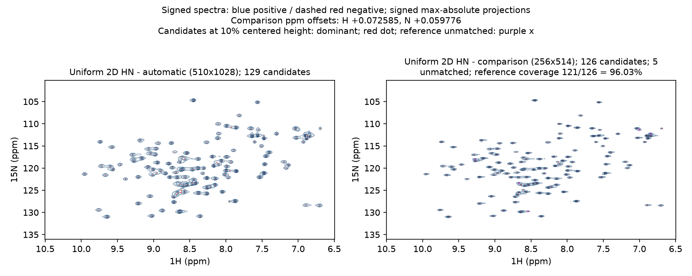
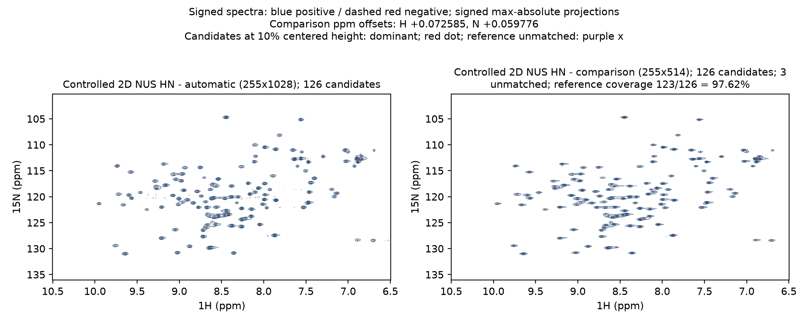
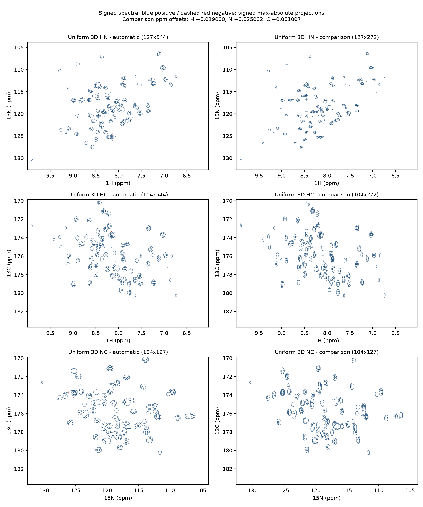
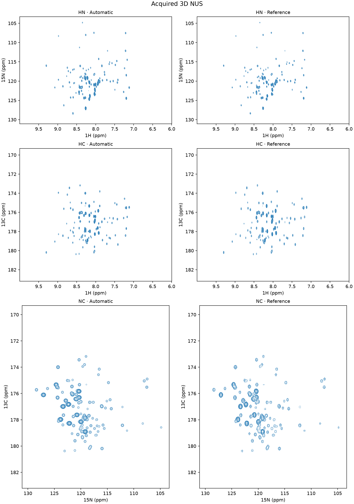

# NMRFinesse 实测证据

## 如何读图

左图是 NMRFinesse 自动处理谱，右图是参考谱。蓝色实线为正信号，红色虚线为负信号。等高线从各图最大绝对强度的 7.5% 开始。红点是检出的候选峰，紫色叉号是未匹配的参考候选峰。

两谱分别以中位数为基线，按本谱最大绝对峰高的 10% 独立选峰。主符号由各符号候选峰的信噪比平方和确定。对同号候选峰进行一对一匹配，联合归一化距离不超过 1，各轴容差为 H 0.02 ppm、N 0.20 ppm、C 0.15 ppm。整轴定标平移保留谱内峰间距。三维谱先裁取共同体积，再生成保留符号的 HN、HC、NC 最大绝对值投影，各投影独立选峰和匹配。

## 数据与参考

| 路径 | 对照方式 |
| --- | --- |
| 2D 均匀采样 | 均匀采集数据的自动处理谱与参考谱对照 |
| 受控 2D NUS | 对均匀采集数据受控下采样，重构后与均匀采样参考谱对照 |
| 3D 均匀采样 | 自动处理谱与完整三维参考谱逐投影对照 |
| 实采 3D NUS | 按实际采样表重构，与完整三维参考谱逐投影对照 |

## 结果概览

| 路径 | 参考候选峰匹配 | 统计 |
| --- | --- | --- |
| 2D 均匀采样 | HN 121/126 | [JSON](../../../docs/evidence/statistics/uniform2d-comparison.json) |
| 受控 2D NUS | HN 123/126 | [JSON](../../../docs/evidence/statistics/nus75-comparison.json) |
| 3D 均匀采样 | HN 83/84、HC 76/81、NC 66/71 | [JSON](../../../docs/evidence/statistics/uniform3d-comparison.json) |
| 实采 3D NUS | HN 89/89、HC 93/93、NC 79/79 | [JSON](../../../docs/evidence/statistics/acquired3d-comparison.json) |

候选峰覆盖率为匹配对数除以参考候选峰数，反映两份检出列表的对应程度。候选数受重叠、峰形和检出阈值影响。同一个三维信号可能出现在多个投影中，投影计数分别解读。

## 2D 均匀采样

自动处理谱检出 129 个 HN 候选，与参考谱的 126 个候选匹配 121 对。已匹配峰的绝对位移差中位数为 H 0.00051 ppm、N 0.00926 ppm。5 个未匹配参考位置中，4 个达到局部检出阈值但未形成独立匹配候选，1 个低于阈值。

### 处理参数

| 维度 | 窗函数 | 基线多项式阶数 |
| --- | --- | --- |
| F2 | SP，off 0.45，end 0.98，二次 | 3 |
| F1 | SP，off 0.65，end 1.00，二次 | 3 |

直接维裁剪至 10.5–6.5 ppm。处理记录包含时域直流偏置修正和最终变换脚本。

## 受控 2D NUS

受控下采样用于检验重构路径。重构谱与均匀采样参考谱各检出 126 个 HN 候选，匹配 123 对。绝对位移差中位数为 H 0.00122 ppm、N 0.00723 ppm。3 个未匹配参考位置中，1 个达到局部检出阈值但未形成独立候选，2 个低于阈值。

### 处理参数

| 维度 | 窗函数 | 基线多项式阶数 |
| --- | --- | --- |
| F2 | SP，off 0.45，end 0.98，一次 | 3 |
| F1 | EM，3 Hz | 2 |

SMILE 按采样表重构 F1。F2 使用重构路径的 SP 窗，F1 窗在终处理阶段应用。

## 3D 均匀采样

| 投影 | 自动／参考候选峰 | 匹配对数 | 绝对位移差中位数（ppm） |
| --- | --- | --- | --- |
| HN | 85 / 84 | 83 | H 0.00104，N 0.01234 |
| HC | 76 / 81 | 76 | H 0.00101，C 0.02934 |
| NC | 69 / 71 | 66 | N 0.01378，C 0.02782 |

三个投影共 11 条未匹配记录，其中 8 条涉及近邻候选竞争同一个一对一配对，2 条局部响应低于阈值，1 条有局部响应但未形成独立候选。

### 处理参数

F3 使用 SP（off 0.65，end 1.00，二次），F2 不加窗，F1 使用 SP（off 0.45，end 0.90，一次）。直接维裁剪至 10.0–6.0 ppm，终跑使用自动填零和时域直流偏置修正，频域基线校正关闭。

## 实采 3D NUS

| 投影 | 自动／参考候选峰 | 匹配对数 | 绝对位移差中位数（ppm） |
| --- | --- | --- | --- |
| HN | 94 / 89 | 89 | H 0.00031，N 0.00989 |
| HC | 98 / 93 | 93 | H 0.00028，C 0.00312 |
| NC | 84 / 79 | 79 | N 0.01068，C 0.00383 |

三个投影的参考候选全部匹配。按同一检出规则，自动谱在每个投影另有 5 个候选。

### 处理参数

F3 使用重构路径的 SP 窗（off 0.45，end 0.98，二次）。SMILE 重构间接维，终处理的 F2 使用 EM 10 Hz，F1 使用 SP（off 0.65，end 1.00，二次）。频域基线校正关闭。

## 自动相位与变换编码

下表为自动处理脚本实际应用的各逻辑维零阶相位。这四组的实际一阶相位均为零。相位按 NMRPipe 约定记录，候选峰比较使用整轴定标后的终谱。

| 路径 | F1 P0 | F2 P0 | F3 P0 | 终跑脚本中的 FT 编码 |
| --- | --- | --- | --- | --- |
| 2D 均匀采样 | 265° | 0° | — | F1、F2 使用 FT |
| 受控 2D NUS | 85° | 173.559° | — | F1、F2 使用 FT |
| 3D 均匀采样 | 2.5° | 267.5° | 15° | F1 使用 FT -alt |
| 实采 3D NUS | 0° | 182.5° | 107.969° | F1 使用 FT -alt，F2 使用 FT -alt -neg |

## 方法、记录与复现

[处理记录](../../../docs/evidence/statistics/processing.json)包含实际转换和处理脚本、采用的相位与窗函数设置，以及选中候选的评分。各路径统计 JSON 保存裁剪区间、定标平移、容差、候选数、坐标差和峰宽。[未匹配候选核查](../../../docs/evidence/statistics/local-response-audit.json)列出每个未匹配参考位置的局部响应及附近自动候选数。

[比较工具](../../../scripts/vm_projection_report.py)生成匹配统计，[绘图工具](../../../scripts/vm_four_path_figure.py)生成对照图。复核时使用全部投影、10% 峰高阈值、主符号规则和统计文件所列整轴平移。

## 与 POKY/iPick 的选峰结果对照

NMRFinesse 与 POKY/iPick 的 UCSFtool 路径都采用阈值筛选、邻域局部极大值检测和逐轴三点抛物线定位。对 12 张二维 HN 正峰谱使用等效阈值，24 张峰表的候选数全部一致，5,175 条候选记录均在每轴一个网格步内唯一配对。坐标差典型值约为 0.00025 ppm，最大约为 0.00050 ppm，处于 iPick 保留三位小数的精度量级。4 张等阈值表复用结果。

下游可用性核查另有 8,084/8,088 格一致。4 格差异来自同一成员和同一次运行在四个对照中的重复。可用性统计与峰表候选数、坐标配对分别解读。

[峰表统计](../../../docs/evidence/ipick/table_comparison.csv) · [候选峰配对](../../../docs/evidence/ipick/candidate_pairs.csv) · [可用性统计](../../../docs/evidence/ipick/matching_comparison.csv) · [核验脚本](../../../docs/evidence/ipick/verify_tables.py)

下载 `ipick` 目录后运行 `python verify_tables.py`，可核对文件哈希、配对唯一性、坐标容差和可用性计数。
