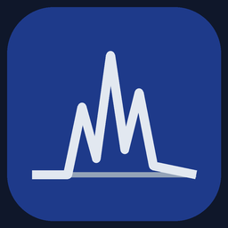

# 图形界面指南

桌面程序是处理谱图的正式界面。本页是界面的导览;底层引擎的行为见
[processing-model.md](processing-model.md) 与 [qc-system.md](qc-system.md)。



> **语言说明:本页是中文文档。** 英文是界面的源语言,菜单与面板默认是英文;同一份构建也带
> 中文界面(跟随系统语言,在「设置 → 软件设置 → 界面语言」里选,或用 `NMRFINESSE_LANG=zh`
> 临时钉死)。中文文案在
> [`ui_support/locales/zh.json`](../../ui_support/locales/zh.json),与英文版是**同一份代码**。

## 启动

```bash
python main.py
```

Linux 是目标运行平台。AppImage 在 `BUILD_INFO.txt` 中记录确切源码提交，也可通过 `--licenses` 查看；可用产物见
[Releases](https://github.com/RociferX/nmrfinesse/releases)。首次正常运行会装桌面菜单项
(`--remove-desktop` 移除),构建与验收记录见 [packaging.md](packaging.md)。

GUI 启动时会探测 NMRPipe 和 SMILE 并报告可用状态。这不表示所有操作都需要这些工具：已有处理谱
可用纯 Python 做谱图 QC 和选峰；生成新的处理谱需要 NMRPipe，NUS 重构还需要 SMILE。

## 窗口布局

窗口是**四列**(列边界可拖;视图菜单只控制其中三列的显示):

| 列 | 显示内容 |
| --- | --- |
| 第 1 列 | 项目树:项目 -> 实验 -> 输入 / 处理 / 输出 / 图形。选中节点即为其余面板设定上下文。 |
| 第 2 列 | 所选数据集的处理流水线:面包屑,加上按状态驱动的步骤列表与「下一步做什么」提示。 |
| 第 3 列 | 任务日志,常驻的中间竖列。单数据集、数据组和全局日志分别保存;单独处理组成员时写成员日志,整组处理写组日志。 |
| 第 4 列 | 谱图面板:切换到样品数据时自动显示当前谱图(大谱在后台读取);3D 默认显示 F3–F2 平面。放大后可在左侧参考谱与中间当前谱之间比对,控件独立且绘图区等高。 |

实验页的单条、分段和批量导入表单始终内嵌在页面里;页面较长时在该页滚动到导入区即可,也可继续从项目树右键导入。

菜单:`文件`(新建/打开/保存项目、最近项目)、`实验`(新建/重命名/删除实验)、
`查看`(收起/展开 项目树 / 流水线 / 谱图)、`工具`(数据质量检测、谱图质量评估)、`设置`(软件设置)、
`帮助`(使用教程、关于)。**`帮助 → 使用教程`** 弹出随包的教程文档(有哪些功能、怎么用,按当前界面语言),正文在 `nmrfinesse_data/tutorial/{zh,en}.md`。

`设置 → 软件设置` 里可以改:界面语言(跟随系统 / 中文 / 英文)、NMRPipe 路径、
数据总目录、各核默认线宽与对齐容差、SMILE 线程数(开发态还有「简单模式」)。这些都写进本地
覆盖配置(`nmrfinesse_data/config/nmrfinesse.local.yaml`;AppImage 里是
`~/.config/NMRFinesse/nmrfinesse.local.yaml`),重启后生效。

「数据总目录」用于设置导入浏览窗口的默认起始目录；已有输入路径时优先使用该路径。
留空或目录不可用时回退到用户主目录。设置标签和输入框提供悬浮说明；空间不足时表单可滚动。

## 处理流水线

四个步骤,每步一个状态 —— `未就绪`(锁定,前置条件未满足)、`可运行`(就绪)、`运行中`、
`已完成`、`失败`、`已过期`(事后输入或参数变化):

| 步骤 | 标签 | 做什么 |
| --- | --- | --- |
| 1 | 生成 FID | 把原始 Bruker 数据转换为 NMRPipe FID(用生成的 `fid.com` 跑 `bruker -AUTO`)。 |
| 2 | 生成谱图 | 执行优化后的处理路径,含 NUS 数据的 SMILE 重构。 |
| 3 | SMILE 优化 | 可选:对重构参数候选做扫描排名。仅 2D NUS;它不会自动替换活动谱。 |
| 4 | 峰挑选 | 自动选峰,并评估强度与 S/N。 |

步骤按顺序解锁。已完成步骤的输入或参数发生变化后会被标为 `已过期`,而不是被静默复用 ——
该步骤会记录自己的输入、脚本与参数指纹。

生成 FID 的人工 `fid.com` 编辑器为各维 CAR 提供可输入的下拉框：当前脚本值、采集中心
O1/BF1、采集文件中记录的 O1P（存在时）、旧脚本的 O1/SFO1，以及由直接维参考或记录温度
下的水峰参考按核频率比推得的值。仅在所需采集元数据存在时显示对应选项。各维下拉框并排为
一行；下方共用解释随当前操作维度更新，每项也有悬浮说明。打开编辑器保留当前值；选择建议
会更新脚本，手输值按 Enter 确认，离焦或 Escape 丢弃草稿。这些选择基于采集元数据，不会
自动替换参考口径。

## 一次典型会话

界面内自带逐步走查:`帮助 → 使用教程`(正文 `nmrfinesse_data/tutorial/{zh,en}.md`)。下面是同一
流程的简版;每一步的按钮位置与分支见教程。

1. **新建或打开项目**(`文件 → 新建项目...` / `最近项目`),然后**导入**一个 Bruker 数据目录
   (在项目树里右键实验节点 ->「导入样品数据...」)。只接受含 Bruker 参数文件的目录;选错会当场
   提示,不会留下半个数据集。**分段采集 / 重复实验叠加**走「分段数据或重复实验叠加导入」
   (容器目录,合并成**一条**数据);**多份独立 2D 数据**走「批量处理」分组 —— 两者是**两件事**,
   详见下面的小节。
2. **核对理解结果**:实验类型及其证据、采样分类与维度布局。如果分类不对,可以在处理前修正
   实验模板 —— 这比处理完再补救便宜得多。这是后面所有自动选择的依据。
3. **生成 FID** → **确定直接维范围**(可选,步骤行上的「直接维范围」,默认 6.5–10.5 ppm)→
   **生成谱图**(步骤会自动解锁)。数据质量检测先跑,结论在任何优化步骤之前写进日志。
   生成 FID 需要机器上有 **NMRPipe**;NUS 数据的 SMILE 重构在生成谱图这一步自动包含。
   对已有处理谱做 QC 和选峰不需要 NMRPipe。
4. **读运行结束时的报告**:最终谱图质量(信噪比、相位、基线与伪影分项)、数据质量检测一节,
   以及解析后的处理参数(包括优化器自己选的),还有直接维范围与 CAR 载频口径。先看报告再看谱。
5. **看谱**:点步骤行上的**「展示谱图」**在第 4 列打开终谱 —— 滚轮缩放、中键平移、强度滑块、
   叠加谱图,点峰表里的行可以跳到对应峰。
6. **按需调整**(看完谱常做,做完再去选峰):改谱中心 ⇒ 在**生成谱图步骤**人工修改 `CAR` 后运行;
   翻转间接维 ⇒ 选好维再点**「重新运行终脚本」**;其它改动 ⇒ 走**人工**改脚本后运行。
7. **选峰**并导出峰表(POKY / Sparky `.list`)。选的峰不合适时,**改阈值再选**,或**指定参考谱**
   后再选(只保留与参考峰表匹配的峰)。导出分**直接导出**(原坐标)与**对齐后导出**(对选定参考
   峰表做整体平移对齐);也能从 `.list` **导入**峰表。
8. **取结果**:峰表用 `Export peaks` 导出;处理好的谱图在该数据集工作目录的 **`spectra` 文件夹**
   里(NMRPipe 终谱 `.ft2`/`.ft3`,以及导出的 **UCSF**,与终谱同名、扩展名 `.ucsf`)。

**补充入口**:谱图步骤完成后,步骤行上的「重新运行终脚本」复用已有脚本、**不重新优化**,只改
直接维范围与间接维翻转(翻转控件与重跑按钮同框:2D 复选框是状态、3D 下拉是命令);峰挑选步骤行
上的「参考谱」可以选一份已有峰表的数据作参考,让峰挑选只保留与参考峰表匹配的峰。**手工路径** ——
任何生成的脚本都能在脚本编辑器里打开、修改并直接运行。成功运行后步骤报告会列出相对上次成功脚本
的命令与参数差异;失败运行会标为「尝试过的改动」,不把它当作成功结果。步骤失败时步骤行上有
「查看日志」直接跳到日志位置。重跑或优化成功后会刷新对应数据的谱图,不会切换当前选中的数据。

谱图查看器的数值标签和单位在微调箭头外侧。输入数值后按 Enter 应用;箭头或方向键仍按步长即时调整。
纵横比也可输入小数(例如 `0.8`)并按 Enter;`0` 表示自由比例。切换样品数据时会自动显示谱图;
3D 首次显示 F3–F2 平面,较大的谱文件在后台加载。

放大比对时,左侧是参考谱,中间是当前谱;两边查看器的显示控件独立,绘图区会对齐到同一高度。
Contour start、Levels、Aspect 的数值与滑块各自成组，保持自然高度和顶部对齐；空间不足时分行显示，宽度恢复后重新横排。
「对齐后导出」只平移导出的峰表,不会改动谱文件。匹配率低时会提示检查参考谱并跳过对齐导出,当前峰表和谱图保持原样。

## 分段采集 / 重复实验叠加的导入

一次采集被拆成几段(**分段 NUS**,各段互补拼满采样网格),或同一实验重复采了多次想叠加提高
信噪比时,用这条途径:**不要**逐段当独立数据导入。入口有两个(效果相同):导入对话框里勾选
「分段数据或重复实验叠加导入(容器目录:多个含 acqus 的子目录合并为一条数据)」,或直接用实验
页面导入区的**「分段数据或重复实验叠加导入」**分组。

容器目录 = **顶层没有 `acqus`**、下面有 **≥ 2 个各含一套 `acqus` 的子目录**;选到这样的目录时
对话框里的勾选会**自动打上**;勾了但不是这种结构会明确报错。导入后这些段**合并成一条数据**
参与后续全部流程(只跑一次生成 FID / 生成谱图)。

## 数据组与批量处理

**批量导入多份各自独立的数据**,用实验页面导入区的**「批量处理」**分组:「添加数据文件夹...」
逐个加入 → **「批量导入并成组(仅支持 2D 谱)」默认勾上**(勾上则导入后进同一个数据组,可整组一起
处理)→ 点「批量导入」,结束给汇总(总数 / 成功 / 失败)。也可以在项目树里右键数据组节点增删成员。

**批量处理仅支持 2D**:非 2D 数据会被跳过并说明原因;失败按数据集隔离,单个坏数据不会中断整组。

`工具 → 数据质量检测`可选择单个 FID 文件或包含切片的文件夹;两种检查都只读,不会改写 FID 或处理记录。
峰定位使用三点抛物线顶点,这是唯一方法,没有方法选择器。

## 独立查看器

```bash
nmrfinesse-viewer          # 完成可编辑安装之后
python -m viewer
```

查看器可以拖放打开 `.ft2`/`.ft3` 文件,保留最近文件列表,用强度滑块叠加谱图、标记峰,并支持
带投影的 3D 切片。

## GUI 把东西写在哪里

所有状态都在你选定的项目目录里:项目文件、每个数据集的工作目录、生成的脚本、运行记录与日志。
删除项目数据走操作系统回收站(可恢复),而不是直接抹掉。

**一个例外:NUS 坏采样点的清理会就地改写原始目录。** 程序删掉坏点时会**就地改写**原始目录里的
`ser` 与 `nuslist`(整行删除),改写前先把原件复制成同目录的 `ser.bak` / `nuslist.bak`
(已存在则不覆盖),日志写明 `Source cleanup …(backup .bak)`;目的是让重构拿到干净输入。
**原始数据只读、或不接受原件被改写时,请先自备副本** —— 源目录的 `.bak` 是回退用的那一份。

## 谱图分区与比对

查看器分为文件/图层、绘图、显示/切片控制和峰工具四区。绘图区常驻，其余可折叠，峰区默认收起。放大比对时各侧绘图区等高，控制区可独立折叠。8–18pt字号保存后立即应用，小窗口通过整页滚动查看。

从比对菜单加载谱图后，可选择两张或三张兼容的一维谱或二维平面重叠。完整视图覆盖所有谱的联合ppm范围，宽谱不会被窄谱截断；一维强度范围包含所有可见迹线。重绘保留当前缩放，谱图范围变化时恢复完整视图。刻度和鼠标ppm读数覆盖宽谱区域。各谱独立控制颜色、等高线和正负峰显隐；自动拟合只调整整体平移，不改数组或谱头。SVG导出遵循当前坐标、颜色与正负峰显示状态。

放大视图中，已展开的峰表填满侧栏剩余高度。重叠模式隐藏整个峰工具/峰表区域，退出重叠后恢复原折叠状态。自动拟合成功后不再显示匹配率行，进度和错误提示保留。

主工作区右侧和底部保留20逻辑像素边距，使最大化时滚动条位于桌面边缘以内，减少误触虚拟机的边缘拖放检测。整页滚动保留；刻意将鼠标拖到桌面最外缘仍可能触发虚拟机功能。
