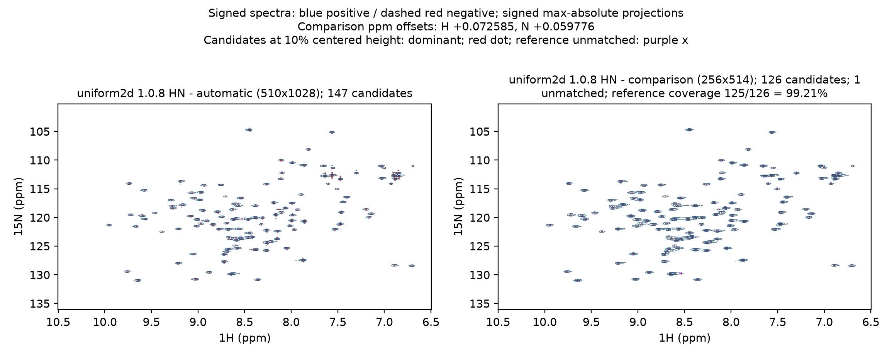
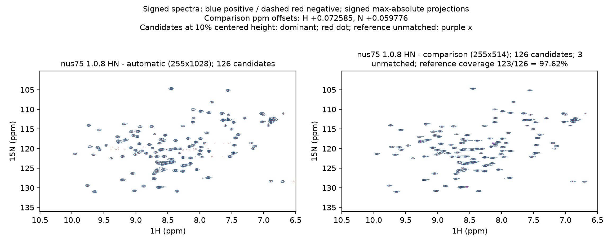
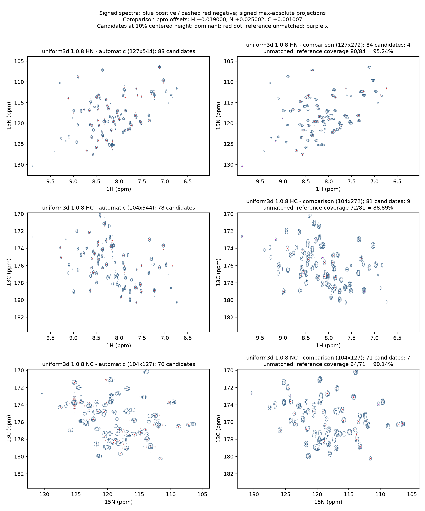
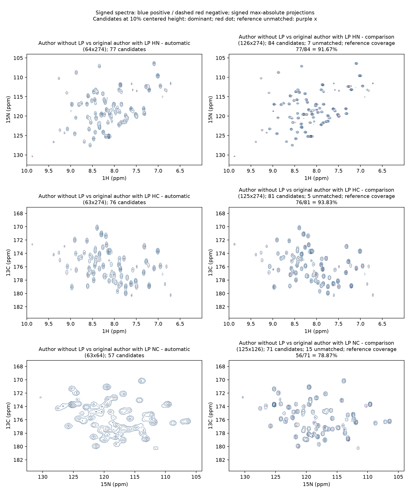
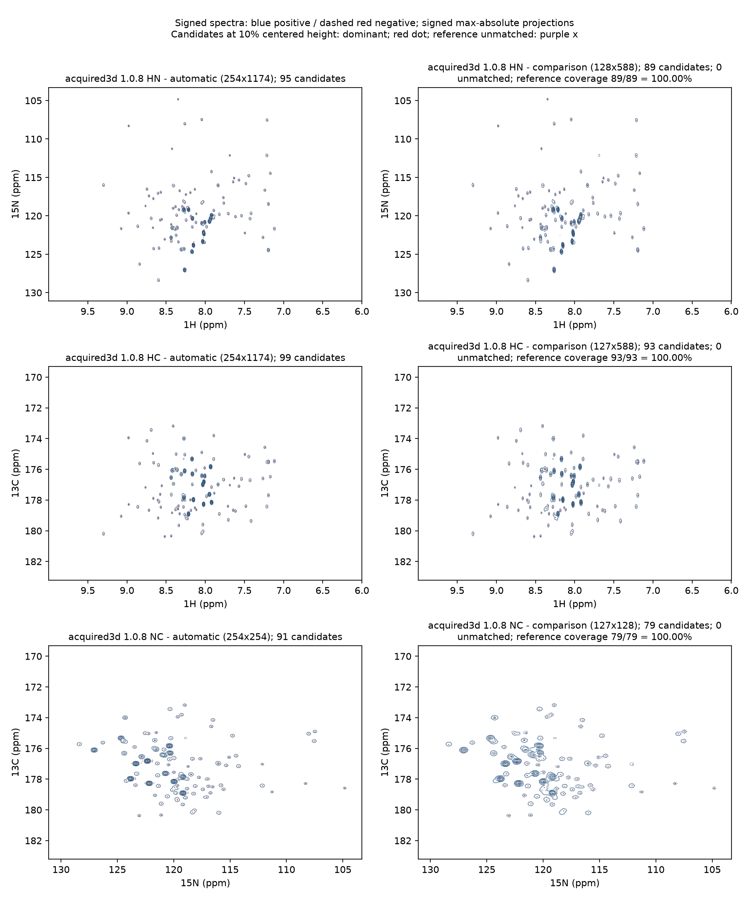

# Four Processing Routes: 2D Spectra and 3D Projection Comparisons

This page presents final spectra produced by software 1.0.8 / API v1.1.4 under the current
processing workflow. All four cases were reprocessed from raw data, measured and plotted on
2026-10-15. Each comparison uses the automatic workflow to generate final phases and processing
parameters; the reference source for each case is listed below.

## How to read the figures

NMRForge is on the left and the reference is on the right. Blue solid contours indicate positive
signals and red dashed contours indicate negative signals. In both panels, contours begin at 7.5%
of that spectrum's maximum absolute intensity. The 7.5% and 10% contours use 0.25 pt lines; higher
contours use 0.4 pt lines. Ordinary candidates are small red dots (`marker='.'`, `s=4`, no outline);
only unmatched reference candidates are marked with purple crosses. For 3D, the shared complete
volume is cropped first, then signed maximum-absolute-value HN, HC and NC projections are generated
and detected/matched independently. Same-sign HSQC/HNCO use `dominant`. Candidate detection uses
10% of each spectrum's maximum absolute peak height after centering on its median baseline. This is
separate from the internal window-scoring thresholds of 12σ/6σ.

**Match rate = matched pairs / reference candidates.** Both spectra are picked independently at the
same 10% threshold, then matched one-to-one by sign. Overlapping peaks, strong-peak side lobes and
weak features near the threshold affect the candidate counts; each figure section describes the
specific cause and corresponding local signal. Negative lobes remain visible as red dashed contours,
while dominant-sign matching focuses matches on the main HSQC/HNCO signals. Each spectrum is shown
with its own normalization, and the whole-axis spectrum centers are aligned using the recorded
source values, preserving relative peak positions.

## Data and references

| Route | Input | Reference |
| --- | --- | --- |
| 2D uniform | BMRB 27493, `Apo_CBL_0.4mM/2`, 90 complex increments | Author Bruker `pdata/1` |
| Controlled 2D NUS | Same uniform raw data; 75% requested, 68/90 = 75.56%, seed 20261008 | Author Bruker `pdata/1` |
| 3D uniform | BMRB 15750 HNCO; complete 32×32 complex grid | Complete 3D spectrum rebuilt from the same raw data using the author's `fid.com`/`proc.com` unchanged |
| Acquired 3D NUS | BMRB 52533 HNCO; 441/(42×42) = 25% | Deposited `DomainIV_HNCO.ft3` |

Sources: [BMRB 27493](https://bmrb.io/data_library/summary/?bmrbId=27493),
[BMRB 15750](https://bmrb.io/data_library/summary/?bmrbId=15750), and
[BMRB 52533](https://bmrb.io/data_library/summary/?bmrbId=52533). The controlled 2D NUS input was
generated by downsampling uniform raw data and is compared directly with the corresponding author
Bruker final spectrum. The complete 15750 3D reference was reconstructed by running the author's
processing scripts unchanged; for 52533, the deposited complete 3D final spectrum was read directly.

## Results overview and strengths of the automatic workflow

The main signal positions in all four spectra correspond well to the author's processing results.
Review of each unmatched location shows differences from a strong-peak side lobe selected
separately, overlapping peaks that cannot be split one-to-one, or a weak peak below the shared
detection threshold; the corresponding local signal remains visible. The author added LP and
experiment-specific windows that improve some weak peaks and linewidths. The general automatic
workflow also produces good spectra under different processing schemes, demonstrating reliable
performance across these cases.

- **Independent automatic processing yields consistent spectral structure.** NMRForge automatically
  parses the raw Bruker data, optimizes phase, windows and baseline, and completes the final run
  without copying the author's final phases or experiment-specific LP/window scheme. All four routes
  recover the corresponding main signals, and both NUS cases reconstruct successfully.
- **Automatic phases are close to the author's.** After joint sign-equivalence comparison, the
  52533 H/N/C residuals are 0.969°/2.50°/0°; for 15750 the N/C residuals are each 2.50°, and the H
  phase curve differs from the author's P1-containing phase by 3.61° near 8 ppm. The automatic
  results are close to the author's manual settings in the main signal region.
- **Acquisition encoding is identified correctly.** The 2D Echo–AntiEcho data are converted using
  their actual encoding; the 15750 carbon-dimension FT uses `-alt`; and the 52533 nitrogen `-alt
  -neg`, carbon `-alt` and SMILE encoding agree with the author's scripts, preserving axis direction
  and overall sign.
- **The spectral-width conflict is resolved correctly.** For 15750, carbon `SW_h` conflicts with
  `SW×SFO1`; the software applies the general rule and resolves the width to 3636.364 Hz, matching
  the value used in the author's conversion. The original parameters, conflict and selected value
  are recorded.
- **The resolution difference has a directly measured processing cause.** The author applied LP in
  both indirect dimensions of 15750. Keeping all other author commands unchanged and disabling only
  the two LP operations increases the local N linewidth by about 1.94× and C by 1.22×, while H is
  about 1.00×. The author's narrower N lines result from this additional experiment-specific
  processing.

## 2D uniform: comparison with the author's Bruker spectrum



NMRForge detected 147 candidates and the author spectrum 126; 125 pairs matched (99.21%). **The
only unmatched candidate is a relatively strong positive side lobe next to an author's strong peak,
selected as a separate candidate** (about H 8.544, N 129.748 ppm). Its local response is 7.84% of
the automatic spectrum's maximum, below the 10% candidate threshold, while the shoulder/side-lobe
structure remains visible. The difference reflects candidate splitting while the main signal agrees.
The automatic H and N dimensions use no window, unlike the author's window, and still correspond well.
The author's whole-axis shifts of H +0.072584594 and N +0.059775701 ppm align the reference using
the frozen strong-peak anchors.

| Projection | NMRForge / reference candidates | Matched / reference candidates | Median absolute position difference (ppm) |
| --- | --- | --- | --- |
| HN | 147 / 126 | 125/126 = 99.21% | H 0.00100; N 0.00805 |

Median local equivalent-linewidth ratio, NMRForge/reference, among matched candidates: HN H 0.82 / N
0.93, estimated from local half-height widths of matched candidates.

Automatic end-to-end processing took 33.165 s and produced a 512×1028 final spectrum.

[Comparison statistics and unmatched coordinates](2d-uniform-author-comparison_20261015.json);
[local-response audit](local-response-audit_20261015.json).

### Processing script and parameter comparison

The automatic script below is the actual final run. The table identifies logical-axis settings by
Bruker nucleus; axes not listed as selected retained normal processing defaults. The complete
commands below define what actually ran.

| Nucleus / logical axis | Window explicitly selected for this run |
| --- | --- |
| 1H / F2 | `{"type": "none"}` |
| 15N / F1 | `{"type": "none"}` |

The author reference is Bruker `pdata/1` in the same source directory; WDW=4, SSB=2, LB=GB=0,
and H/N SI=2048/256. Author Bruker phases are listed using their original PHC convention; the 2D
phase effect is compared through the final peak shape and overall sign.

<details>
<summary>Show the actual automatic conversion and final-processing scripts for this case</summary>

**Automatic conversion**

```csh
#!/bin/csh

bruk2pipe -verb -in ./ser \
  -bad 0.0 -ext -aswap -AMX -decim 2088 -dspfvs 20 -grpdly 67.9876556396484  \
  -xN              2048  -yN               180  \
  -xT              1024  -yT                90  \
  -xMODE            DQD  -yMODE  Echo-AntiEcho  \
  -xSW         9578.544  -ySW         2187.227  \
  -xOBS         599.503  -yOBS          60.754  \
  -xCAR           4.771  -yCAR         118.077  \
  -xLAB 1H  -yLAB             15N  \
  -ndim               2  -aq2D         Complex  \
| nmrPipe -fn MULT -c 9.76562e-01 \
  -out ./d_001.fid -ov
```

**Automatic final processing**

```csh
#!/bin/csh
# NMRForge processing script
# experiment: d_001
xyz2pipe -in d_001.fid -x \
| nmrPipe -fn POLY -time \
| nmrPipe -fn ZF -size 4096 \
| nmrPipe -fn FT \
| nmrPipe -fn PS -p0 0 -p1 0 -di \
| nmrPipe -fn POLY -ord 3 -auto \
| nmrPipe -fn EXT -x1 10.5ppm -xn 6.5ppm -sw -round 2 \
| nmrPipe -fn TP \
| nmrPipe -fn ZF -size 512 \
| nmrPipe -fn FT \
| nmrPipe -fn PS -p0 265 -p1 0 -di \
| nmrPipe -fn POLY -ord 3 -auto \
| nmrPipe -fn TP \
| pipe2xyz -out d_001.ft2 -x
```

</details>

<details>
<summary>Show the author's deposited parameters</summary>

**procs**

```text
##$BC_mod= 6
##$GB= 0
##$LB= 0
##$OFFSET= 12.68878
##$PHC0= 7.599999
##$PHC1= 0
##$SF= 599.5
##$SI= 2048
##$SSB= 2
##$SW_p= 9578.54406130266
##$WDW= 4
```

**proc2s**

```text
##$BC_mod= 0
##$GB= 0
##$LB= 0
##$OFFSET= 136.0028
##$PHC0= -2.4
##$PHC1= 0
##$SF= 60.74680744
##$SI= 256
##$SSB= 2
##$SW_p= 2187.22659667541
##$WDW= 4
```

</details>

## Controlled 2D NUS: 75% requested, 75.56% actual



The input was regenerated with `vm_make_evidence_nus.py`: 68 of the 90 full orthogonal increments
were retained, including the zero and terminal increments, for 75.56% sampling. The new input was
reimported, converted and run through complete SMILE final processing, then compared directly with
the author's Bruker `pdata/1` spectrum using the H window 10.5–6.5 ppm. The whole-axis reference
shifts are the same as for 2D uniform: H +0.072584594 and N +0.059775701 ppm.

NMRForge and the author each have 126 candidates, with 123 pairs matched (97.62%). **All three
unmatched locations have visible corresponding local signals:**

- About H 9.275, N 118.058 ppm: two nearby peaks detected separately by the author overlap as one
  broader maximum in the automatic NUS spectrum, so one-to-one matching counts one fewer pair.
- About H 8.131, N 118.612 ppm: a weak shoulder remains visible, with local peak height about 8.15%
  of the strongest peak in this spectrum, below the shared 10% detection threshold.
- About H 8.544, N 129.748 ppm: the same author's strong-peak side lobe seen in the uniform case;
  its local response in the automatic spectrum is about 9.18%, so it is not listed separately at
  the 10% threshold.

With only 75.56% of increments retained, automatic NUS reconstruction preserves the main structure
corresponding to the author's uniform spectrum as well as these local weak signals.

| Projection | NMRForge / reference candidates | Matched / reference candidates | Median absolute position difference (ppm) |
| --- | --- | --- | --- |
| HN | 126 / 126 | 123/126 = 97.62% | H 0.00125; N 0.00738 |

Median local equivalent-linewidth ratio, NMRForge/reference, among matched candidates: HN H 0.86 / N
1.37. Estimated from local half-height widths of matched candidates.

Automatic end-to-end processing took 17.102 s and produced a 256×1028 final spectrum.

[Comparison statistics and unmatched coordinates](controlled-2d-nus75-comparison_20261015.json);
[local-response audit](local-response-audit_20261015.json).

### Processing script and parameter comparison

The automatic script below is the actual final run. The table identifies logical-axis settings by
Bruker nucleus; axes not listed as selected retained normal processing defaults. The complete
commands below define what actually ran.

| Nucleus / logical axis | Window explicitly selected for this run |
| --- | --- |
| 1H / F2 | `Fixed NUS direct-dimension SP: off .45 / end .98 / pow 2 / c .5` |
| 15N / F1 | `{"c": 1.0, "lb": 5.0, "type": "exp"}` |

The reference is the author's Bruker `pdata/1`; its WDW=4, SSB=2, LB=GB=0 and H/N SI are 2048/256.
The automatic NUS direct dimension uses fixed SP off .45 / end .98 / pow 2 / c .5; the indirect
dimension uses EM 5 Hz selected by automatic scoring.

<details>
<summary>Show the actual automatic conversion and final-processing scripts for this case</summary>

**Automatic conversion**

```csh
#!/bin/csh

nusExpand.tcl -yT 90 -mode bruker -sampleCount 68 -avg -off 0 \
 -in ./ser -out ./ser_full -sample ./nuslist

bruk2pipe -verb -in ./ser_full \
  -bad 0.0 -ext -aswap -AMX -decim 2088 -dspfvs 20 -grpdly 67.9876556396484  \
  -xN              2048  -yN               180  \
  -xT              1024  -yT                90  \
  -xMODE            DQD  -yMODE  Echo-AntiEcho  \
  -xSW         9578.544  -ySW         2187.227  \
  -xOBS         599.503  -yOBS          60.754  \
  -xCAR           4.771  -yCAR         118.077  \
  -xLAB 1H  -yLAB             15N  \
  -ndim               2  -aq2D         Complex  \
| nmrPipe -fn MULT -c 9.76562e-01 \
  -out ./d_001.fid -ov
```

**Automatic final processing**

```csh
#!/bin/csh
# NMRForge 2D NUS SMILE reconstruction (two-stage)
# experiment: d_001
mkdir -p nus2d
# stage 1: direct dim (F2) FT + EXT + POLY, SMILE reconstruct F1
nmrPipe -in d_001.fid \
| nmrPipe -fn POLY -time \
| nmrPipe -fn SP -off 0.45 -end 0.98 -pow 1 -c 0.5 \
| nmrPipe -fn ZF -zf -size 4096 \
| nmrPipe -fn FT \
| nmrPipe -fn EXT -x1 10.5ppm -xn 6.5ppm -sw -round 2 \
| nmrPipe -fn PS -p0 173.559 -p1 -0 -di \
| nmrPipe -fn POLY -ord 3 -auto \
| nmrPipe -fn TP \
| nmrPipe -fn SMILE -nDim 2 \
           -sample nuslist -nThread 2 \
           -sampleCount 68 -nSigma 5 -off 0 0 -report 1 \
           -maxMem 11.7058 \
           -scaling 1 \
           -maxIter 300 \
           -xT 90 \
           -xP0 85 -xP1 0 \
           -thresh 0.95 \
| pipe2xyz -out nus2d/recon.ft1 -x -ov

# stage 2: indirect dim (F1) window + ZF + FT -alt + PS + POLY
nmrPipe -in nus2d/recon.ft1 \
| nmrPipe -fn EM -lb 5 \
| nmrPipe -fn ZF -size 256 \
| nmrPipe -fn FT \
| nmrPipe -fn PS -p0 85 -p1 0 -di \
| nmrPipe -fn POLY -ord 2 -auto \
| nmrPipe -fn TP \
  -out d_001.ft2 -ov
```

</details>

<details>
<summary>Show the author's deposited parameters</summary>

**procs**

```text
##$BC_mod= 6
##$GB= 0
##$LB= 0
##$OFFSET= 12.68878
##$PHC0= 7.599999
##$PHC1= 0
##$SF= 599.5
##$SI= 2048
##$SSB= 2
##$SW_p= 9578.54406130266
##$WDW= 4
```

**proc2s**

```text
##$BC_mod= 0
##$GB= 0
##$LB= 0
##$OFFSET= 136.0028
##$PHC0= -2.4
##$PHC1= 0
##$SF= 60.74680744
##$SI= 256
##$SSB= 2
##$SW_p= 2187.22659667541
##$WDW= 4
```

</details>


## 3D uniform: BMRB 15750 and the author's complete 3D script-reconstructed spectrum



The raw `ser` is 16,777,216 bytes, consistent with a complete 32×32 complex grid; the reference is a
full 3D spectrum. H/N/C reference shifts of +0.018999577, +0.025001526 and +0.001007080 ppm come
from same-nucleus spectrum-header CAR differences in this run. The three projections have 20 unmatched reference candidates in total. **Each has a
corresponding local positive signal:** 11 have
responses below the shared 10% threshold, eight already have nearby candidates competing in the
one-to-one match, and one appears as a shoulder or overlapping feature rather than a separate
candidate. The automatic spectrum has broader N and narrower H/C features; weak negative structure
and resolution differences are visible in the figure.

**The author's LP settings directly account for the narrower N lines.** The author used `LP -fb`
and experiment-specific windows in the N and C indirect dimensions. To isolate the LP contribution,
the same author's converted FID and every other processing command were retained, while only the two
effective LP operations were disabled. Without LP, local linewidths were about 1.94× wider in N,
1.22× in C and 1.00× in H relative to the run with LP. This directly demonstrates how the author's
experiment-specific processing improves N linewidth and weak-peak display. The automatic workflow
uses a different scheme; its matched peaks are narrower in H and C while the main signal structure
still corresponds.

| Projection | NMRForge / reference candidates | Matched / reference candidates | Median absolute position difference (ppm) |
| --- | --- | --- | --- |
| HN | 83 / 84 | 80/84 = 95.24% | H 0.00086; N 0.01304 |
| HC | 78 / 81 | 72/81 = 88.89% | H 0.00084; C 0.03177 |
| NC | 70 / 71 | 64/71 = 90.14% | N 0.01658; C 0.03039 |

Median local equivalent-linewidth ratios, NMRForge/reference, among matched candidates: HN H
0.68 / N 1.31; HC H 0.69 / C 0.74; NC N 1.33 / C 0.71, estimated from local half-height widths of
matched candidates.

Automatic end-to-end processing took 53.395 s and produced a 128×128×548 final spectrum.

[Author LP on/off comparison statistics](author-lp-comparison_20261014.json) record the linewidth
changes using the same author commands.

<details>
<summary>Show the three-projection comparison with author LP enabled and disabled</summary>

Left: the author's processing with only the two LP operations disabled. Right: the original author
script, with all other processing steps unchanged.



</details>

[Comparison statistics and unmatched coordinates](3d-uniform-bmrb15750-comparison_20261015.json);
[local-response audit](local-response-audit_20261015.json).

### Processing script and parameter comparison

The automatic script below is the actual final run. The table identifies logical-axis settings by
Bruker nucleus; axes not listed as selected retained normal processing defaults. The complete
commands below define what actually ran.

| Nucleus / logical axis | Window explicitly selected for this run |
| --- | --- |
| 1H / F3 | `{"type": "none"}` |
| 15N / F2 | `{"type": "none"}` |
| 13C / F1 | `{"type": "none"}` |

The author used an H-dimension SP and two PS operations (3°/0° and −4°/43°), with indirect-dimension
LP and experiment-specific windows. NMRForge converted the original Bruker data and automatically
optimised phase, windows and baseline; it did not copy the author's final phases or LP scheme. The
carbon `SW_h` conflicted with `SW×SFO1`; NMRForge used 3636.364 Hz, matching the author's conversion.
This follows the general spectral-width policy used for imported data.

<details>
<summary>Show the automatic conversion, automatic final-processing, and original author scripts</summary>

**Automatic conversion**

```csh
#!/bin/csh

bruk2pipe -verb -in ./ser \
  -bad 0.0 -ext -aswap -AMX -decim 1568 -dspfvs 20 -grpdly 67.9841461181641  \
  -xN              1024  -yN                64  -zN                64  \
  -xT               512  -yT                32  -zT                32  \
  -xMODE            DQD  -yMODE Echo-AntiEcho  -zMODE States-TPPI  \
  -xSW        12755.102  -ySW         2500.000  -zSW 3636.364  \
  -xOBS         850.104  -yOBS          86.150  -zOBS         213.795  \
  -xCAR           4.819  -yCAR         118.125  -zCAR         178.251  \
  -xLAB 1H  -yLAB             15N  -zLAB             13C  \
  -ndim               3  -aq2D         Complex                         \
| nmrPipe -fn MULT -c 1.95312e+00 \
| pipe2xyz -x -out ./fid/test%03d.fid -ov
```

**Automatic final processing**

```csh
#!/bin/csh
# NMRForge processing script
# experiment: d_001
xyz2pipe -in fid/test%03d.fid -x \
| nmrPipe -fn POLY -time \
| nmrPipe -fn ZF -size 2048 \
| nmrPipe -fn FT \
| nmrPipe -fn PS -p0 15 -p1 0 -di \
| nmrPipe -fn EXT -x1 10ppm -xn 6ppm -sw -round 2 \
| nmrPipe -fn TP \
| nmrPipe -fn ZF -size 128 \
| nmrPipe -fn FT \
| nmrPipe -fn PS -p0 267.5 -p1 0 -di \
| nmrPipe -fn ZTP \
| nmrPipe -fn ZF -size 128 \
| nmrPipe -fn FT -alt \
| nmrPipe -fn PS -p0 2.5 -p1 0 -di \
| nmrPipe -fn TP \
| pipe2xyz -out d_001.ft3 -x
```

**fid.com**

```csh
#!/bin/csh

bruk2pipe -in ./ser -bad 0.0 -aswap -DMX -decim 1568 -dspfvs 20 -grpdly 67.9841461181641  \
  -xN              1024  -yN                64  -zN                64  \
  -xT               512  -yT                32  -zT                32  \
  -xMODE            DQD  -yMODE  Echo-AntiEcho  -zMODE    States-TPPI  \
  -xSW        12755.102  -ySW         2500.000  -zSW         3636.364  \
  -xOBS         850.104  -yOBS          86.150  -zOBS         213.795  \
  -xCAR           4.800  -yCAR         118.100  -zCAR         178.250  \
  -xLAB              H1  -yLAB             N15  -zLAB             C13  \
  -ndim               3  -aq2D          States                         \
  -out ./data/test%03d.fid -verb -ov

sleep 5
```

**proc.com**

```csh
#!/bin/csh

xyz2pipe -in  data/test%03d.fid -x  -verb           \
| nmrPipe  -fn POLY -time                           \
| nmrPipe  -fn SP -size 512 -off 0.5 -end 1.00 -pow 2 -c 0.5  \
| nmrPipe  -fn ZF -auto                             \
| nmrPipe  -fn FT                                   \
| nmrPipe  -fn PS -p0  3.0 -p1 0                    \
| nmrPipe  -fn PS -p0 -4  -p1 43.0 -di               \
| nmrPipe  -fn EXT -x1 10.0ppm -xn 6.0ppm -sw       \
| pipe2xyz -out data/test%03d.ft3 -x -ov

xyz2pipe -in data/test%03d.ft3 -z -verb               \
| nmrPipe  -fn SP -off 0.5 -end 0.98 -pow 1 -c 0.5  \
| nmrPipe  -fn ZF -auto                             \
| nmrPipe  -fn FT -alt                              \
| nmrPipe  -fn PS -p0 0.0 -p1 0.0 -di               \
| pipe2xyz -out data/test%03d.ft3 -z -inPlace

xyz2pipe -in data/test%03d.ft3 -y -verb               \
| nmrPipe  -fn LP -fb                               \
| nmrPipe  -fn SP -off 0.5 -end 0.98 -pow 1 -c 1.0  \
| nmrPipe  -fn ZF -auto                             \
| nmrPipe  -fn FT                                   \
| nmrPipe  -fn PS -p0 -90 -p1 0 -di                   \
| nmrPipe  -fn POLY -auto -ord 0                    \
| nmrPipe  -fn TP                                   \
| nmrPipe  -fn POLY -auto -ord 0                    \
| pipe2xyz -out data/test%03d.ft3 -y -inPlace

xyz2pipe -in data/test%03d.ft3 -z -verb               \
| nmrPipe  -fn HT  -auto                            \
| nmrPipe  -fn PS  -inv -hdr                        \
| nmrPipe  -fn FT  -inv                             \
| nmrPipe  -fn ZF  -inv                             \
#| nmrPipe  -fn LP -pred 32 -ord 8                   \
| nmrPipe  -fn LP -fb                               \
| nmrPipe  -fn SP  -hdr                             \
| nmrPipe  -fn ZF  -auto                            \
| nmrPipe  -fn FT                                   \
| nmrPipe  -fn PS  -hdr -di                         \
| nmrPipe  -fn CS  -ls 3.0ppm   -sw                   \
| nmrPipe  -fn POLY -auto -ord 0                    \
| pipe2xyz -out data/test%03d.ft3 -z -inPlace

xyz2pipe -in ./data/test%03d.ft3  -y -verb  \
  > ./hnco.ft3
```

</details>

## Acquired 3D NUS: BMRB 52533 and the deposited complete final spectrum



The acquired schedule contains 441 points on a 42×42 complex grid (25% sampling); the `ser` and

uslist` hashes are unchanged. All reference candidates matched in the three projections, with no
additional shift. Automatic SMILE reconstruction preserves the main signal positions, phase and
overall sign corresponding to the author's complete 3D final spectrum.

| Projection | NMRForge / reference candidates | Matched / reference candidates | Median absolute position difference (ppm) |
| --- | --- | --- | --- |
| HN | 95 / 89 | 89/89 = 100.00% | H 0.00033; N 0.00946 |
| HC | 99 / 93 | 93/93 = 100.00% | H 0.00029; C 0.00317 |
| NC | 91 / 79 | 79/79 = 100.00% | N 0.01006; C 0.00335 |

Median local equivalent-linewidth ratios, NMRForge/reference, among matched candidates: HN H 0.95 / N
0.76; HC H 0.94 / C 0.78; NC N 0.75 / C 0.77, estimated from local half-height widths of
matched candidates.

Automatic end-to-end processing took 276.152 s and produced a 256×256×1176 final spectrum.

[Comparison statistics and unmatched coordinates](acquired-3d-bmrb52533-comparison_20261015.json);
[local-response audit](local-response-audit_20261015.json).

### Processing script and parameter comparison

The automatic script below is the actual final run. The table identifies logical-axis settings by
Bruker nucleus; axes not listed as selected retained normal processing defaults. The complete
commands below define what actually ran.

| Nucleus / logical axis | Window explicitly selected for this run |
| --- | --- |
| 1H / F3 | `Fixed NUS direct-dimension SP: off .45 / end .98 / pow 2 / c .5` |
| 15N / F2 | `{"c": 1.0, "g1": 4.0, "g2": 8.0, "g3": 0.0, "type": "gaussian"}` |
| 13C / F1 | `{"type": "none"}` |

The reference reads the deposited `DomainIV_HNCO.ft3` directly. The author's `conv_smile.com` shown
below is method provenance; it was not run to regenerate or alter the deposited spectrum. SMILE/FT
encoding can be compared across the scripts. Automatic indirect phases are passed to SMILE and agree
with the final PS operations; peaks were not aligned individually.

<details>
<summary>Show the actual automatic conversion, automatic final-processing, and author scripts</summary>

**Automatic conversion**

```csh
#!/bin/csh

nusExpand.tcl -zT 42 -yT 42 -mode bruker -sampleCount 441 -avg -off 0 \
 -in ./ser -out ./ser_full -sample ./nuslist

bruk2pipe -verb -in ./ser_full \
  -bad 0.0 -ext -aswap -AMX -decim 1792 -dspfvs 20 -grpdly 67.9841766357422  \
  -xN              2048  -yN                84  -zN                84  \
  -xT              1024  -yT                42  -zT                42  \
  -xMODE            DQD  -yMODE States-TPPI  -zMODE States-TPPI  \
  -xSW        11160.714  -ySW         2269.632  -zSW         2816.901  \
  -xOBS         799.864  -yOBS          81.059  -zOBS         201.160  \
  -xCAR           4.773  -yCAR         117.084  -zCAR         176.207  \
  -xLAB 1H  -yLAB             15N  -zLAB             13C  \
  -ndim               3  -aq2D         Complex  \
| nmrPipe -fn MULT -c 1.95312e+00 \
  -out ./d_001.fid -ov
```

**Automatic final processing**

```csh
#!/bin/csh
# NMRForge 3D NUS SMILE reconstruction
# experiment: d_001
mkdir -p nus3d_1 nus3d_rc
# step 1: direct dim (F3) FT + EXT + PS
xyz2pipe -in d_001.fid -x \
| nmrPipe -fn SP -off 0.45 -end 0.98 -pow 2 -c 0.5 \
| nmrPipe -fn ZF -zf -size 4096 \
| nmrPipe -fn FT \
| nmrPipe -fn EXT -x1 10ppm -xn 6ppm -sw -round 2 \
| nmrPipe -fn PS -p0 107.969 -p1 -0 -di \
| pipe2xyz -out nus3d_1/test%04d.ft1 -z

# step 2: SMILE reconstruct indirect dims (F2/F1)
xyz2pipe -in nus3d_1/test%04d.ft1 -x \
| nmrPipe -fn SMILE -nDim 3 \
           -sample nuslist -nThread 2 \
           -sampleCount 441 -nSigma 5 -off 0 0 -report 1 \
           -maxMem 9.99663 \
           -scaling 1 \
           -maxIter 1500 \
           -xP0 182.5 -xP1 0 \
           -yP0 0 -yP1 0 \
           -xAlt -xNeg \
           -yAlt \
           -thresh 0.95 \
| pipe2xyz -out nus3d_rc/test%04d.ft1 -x

# step 3: indirect dims (F2/F1) window + ZF + FT + PS
xyz2pipe -in nus3d_rc/test%04d.ft1 -x \
| nmrPipe -fn GM -g1 4 -g2 8 \
| nmrPipe -fn ZF -size 256 \
| nmrPipe -fn FT -alt -neg \
| nmrPipe -fn PS -p0 182.5 -p1 0 -di \
| nmrPipe -fn TP \
| nmrPipe -fn ZF -size 256 \
| nmrPipe -fn FT -alt \
| nmrPipe -fn PS -p0 0 -p1 0 -di \
| nmrPipe -fn TP \
| nmrPipe -fn ZTP \
| pipe2xyz -out d_001.ft3 -x
```

**Author `conv_smile.com`**

```csh
#!/bin/csh

set CONVERSION = y
set PROCESSING_1 = y
set RECONSTRUCTION = y
set PROCESSING_23 = y
set PROJECTIONS = y


if ($CONVERSION == 'y') then

nusExpand.tcl -mode bruker -sampleCount 441 -off 0 \
 -in ./ser -out ./ser_full -sample ./nuslist

bruk2pipe -verb -in ./ser_full \
  -bad 0.0 -ext -aswap -AMX -decim 1792 -dspfvs 20 -grpdly 67.9841766357422  \
  -xN              2048  -yN                84  -zN                84  \
  -xT              1024  -yT                42  -zT                42  \
  -xMODE            DQD  -yMODE    States-TPPI  -zMODE    States-TPPI  \
  -xSW        11160.714  -ySW         2269.632  -zSW         2816.901  \
  -xOBS         799.864  -yOBS          81.059  -zOBS         201.160  \
  -xCAR           4.773  -yCAR         117.084  -zCAR         176.207  \
  -xLAB              HN  -yLAB             15N  -zLAB              CO  \
  -ndim               3  -aq2D         Complex                         \
| nmrPipe -fn MULT -c 1.95312e+00 \
| pipe2xyz -x -out ./fid/test%03d.fid -ov


  echo "Expansion & conversion done..."

endif

if ($PROCESSING_1 == 'y') then

echo "Processing Direct dimension..."

xyz2pipe -in ./fid/test%03d.fid -x                    \
| nmrPipe  -fn POLY -time                             \
| nmrPipe  -fn SP -off 0.4 -end 0.98 -pow 2 -c 0.5    \
| nmrPipe  -fn ZF -auto                         \
| nmrPipe  -fn FT                                     \
| nmrPipe  -fn EXT -x1 10ppm -xn 6ppm -sw -round 2  \
| nmrPipe  -fn PS -p0 -73.0 -p1 0.0 -di                 \
#| nmrPipe  -fn POLY -auto   \
| pipe2xyz -out ft1/test%04d.ft1 -z -verb

echo "Direct dimension processing done..."

endif

if ($RECONSTRUCTION == 'y') then
date
echo "Starting reconstruction..."

xyz2pipe -in ft1/test%04d.ft1 -x                           \
| nmrPipe  -fn SMILE -nDim 3 -sample nuslist -nThread 40   \
           -sampleCount 441 -nSigma 5 -off 0 -report 2		\
           -xCT 42 -xAlt -xNeg -yAlt -xQ3 2 -yQ3 2                                    \
| pipe2xyz -out ft1/rc%04d.ft1 -x

endif

if ($PROCESSING_23 == 'y') then

xyz2pipe -in ft1/rc%04d.ft1 -x                        \
| nmrPipe  -fn ZF -auto                         \
| nmrPipe  -fn FT -alt -neg                                     \
| nmrPipe  -fn PS -p0 0 -p1 0 -di                     \
| nmrPipe  -fn TP                                     \
| nmrPipe  -fn ZF -auto                         \
| nmrPipe  -fn FT -alt                                    \
| nmrPipe  -fn PS -p0 0 -p1 0 -di                     \
| nmrPipe  -fn TP                                     \
| nmrPipe  -fn ZTP                                    \
| pipe2xyz -out ft/DomainIV_HNCO_%03d.ft3 -x

proj3D.tcl -in ft/DomainIV_HNCO_%03d.ft3

endif

xyz2pipe -verb -in ft/DomainIV_HNCO_%03d.ft3 -x  \
|  nmrPipe -ov -out DomainIV_HNCO.ft3
```

</details>

## Automatic phase and encoding checks

Phases are compared modulo 360°. For same-sign multidimensional spectra, adding 180° jointly to H and
N preserves the joint sign relationship. An internal phase-consistency check between the same-source
controlled 2D NUS and automatic uniform spectra, after this joint transformation, gives
H/N residuals of 6.441°/0°; the 15750 N/C residuals are each 2.50°. For 15750 H, NMRForge used
15°/0° and the author used −1°/43°, so P1 differs. Both PS operations were applied to the same
complex Fourier-transformed data: the rotation residual in the shared H window was −2.06° to +9.28°,
and 3.61° near 8 ppm. For 52533, H/N/C residuals after joint H/N equivalence are 0.969°/2.50°/0°.
The 15750 carbon `FT -alt`, 52533 nitrogen `-alt -neg`, carbon `-alt`, and Echo–AntiEcho conversion
are verified against the actual scripts.
[This run's phase check](phase-and-encoding-comparison_20261015.json) records original values,
equivalent transformations and phase-operator results.

## Methods, records and reproduction

Matching uses same-sign candidates, H/N/C tolerances of 0.02/0.20/0.15 ppm, a normalized joint
distance ≤1, and a nearest-first one-to-one greedy assignment. For 3D, the common complete volume is
cropped first. The source was software 1.0.8 / API 1.1.4; each case was run once, with automatic
phase selection by axis followed by ordinary baseline/window scoring and a complete final run.
The default window pool contains no window, five SP, two GM and two EM candidates. Window scoring multiplies detection, splitting, symmetry and sidelobe scores by the square of relative linewidth retention, continuously balancing those criteria against resolution. The internal 6σ
fallback is used only when 12σ reference selection finds no eligible reference; it does not change
the 10% display-detection threshold used on this page. NUS keeps the direct SP fixed by default.
The gated lightweight P0 seed may be used at the first 2D NUS reconstruction; it is not used for 3D.
Statistics did not change processing parameters, thresholds or individual peak coordinates.

[Construction manifest](controlled-nus75-construction_20261015.json),
[processing provenance](processing-provenance_20261015.json), and
[the four actual scripts](script-comparisons_20261015.json) record versions, input/final-spectrum
hashes, optimization outcomes and executed commands. Displayed script paths were made relative;
the SHA-256 hashes of the original executed scripts remain in the records, and final-spectrum bytes
were not changed. For ordinary reproduction, use each case's original Bruker directory:

```python
from nmrforge_api import open_study, add_dataset, build_reference
study = open_study("new-evidence-project")
dataset = add_dataset(study, "raw/experiment", condition="A")
reference = build_reference(study, dataset, params={
    "ext_lo": "10.5", "ext_hi": "6.5",
    "final_ext_lo": "10.5", "final_ext_hi": "6.5", "apply_ext_to_opt": True,
})
```

For both 3D cases, use an H window of 10–6 ppm. The 15750 reference was generated by running the
deposited `fid.com`/`proc.com` unchanged; the acquired NUS reference reads the deposited FT3. For the
artificial input, first run:

```bash
python scripts/vm_make_evidence_nus.py raw/uniform raw/nus75 --fraction .75 --seed 20261008
python scripts/vm_projection_report.py --spectrum automatic.ft3 --reference author.ft3 --pairs all --min-height-fraction .10 --sign-mode dominant --json comparison.json
python scripts/vm_four_path_figure.py --case "3D comparison,automatic.ft3,author.ft3" --projection all --mark-peaks --peak-height-fraction .10 --peak-marker-size 4 --peak-sign-mode dominant --out comparison.png
```

Apply the whole-axis reference shifts documented on this page when using the commands above. The
actual scripts and provenance JSON record the complete parameters and selected windows. Across these
four routes, automatic parameter parsing, phase and encoding decisions, uniform processing and NUS
reconstruction all produce spectra that correspond well to the author's results; experiment-specific
LP or window settings further improve display of some weak peaks.
