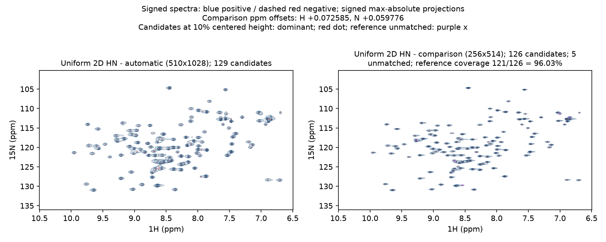
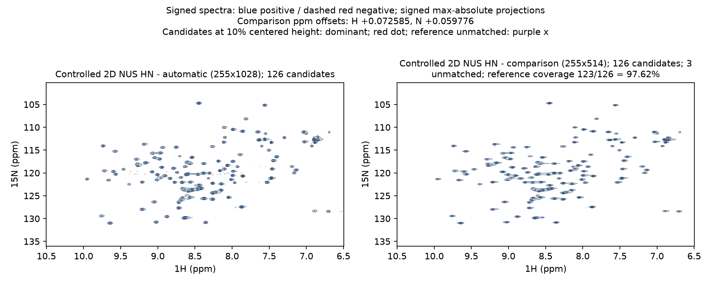
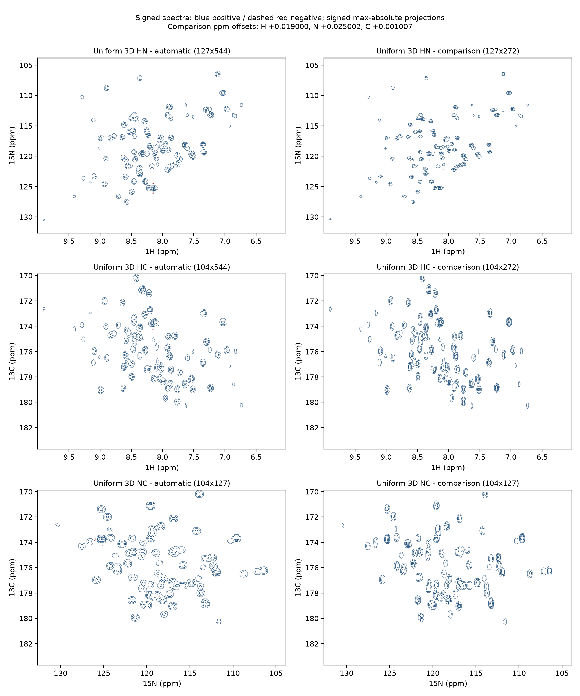
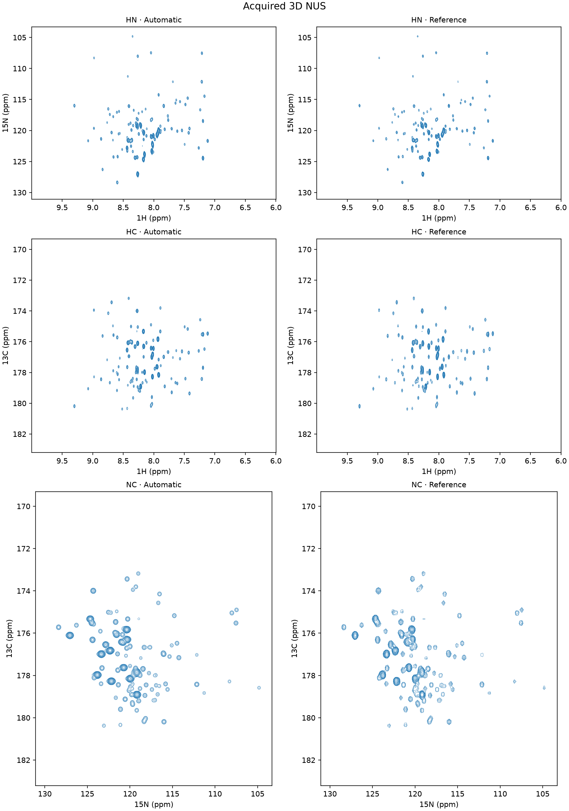

# NMRFinesse validation

## How to read the figures

The automatically processed spectrum is on the left and the author spectrum is on the right.
Blue solid contours show positive signal and red dashed contours show negative signal. Contours
start at 7.5% of each panel's maximum absolute intensity. The 3D figures show signed
maximum-absolute-value HN, HC and NC projections over the common volume. Assignment counts use
the full 3D spectra.

## Data and references

| Route | Comparison |
| --- | --- |
| Uniform 2D | Automatic processing of a uniform acquisition compared with its reference spectrum |
| Controlled 2D NUS | Controlled downsampling of a uniform acquisition, reconstructed and compared with the uniform reference |
| Uniform 3D | Automatic processing compared with a full 3D reference, evaluated through three projections |
| Acquired 3D NUS | Reconstruction of an acquired NUS schedule compared with a full 3D reference |

## Agreement with residue assignments

The reference coordinates come from the public BMRB assignments. HSQC uses H and N from the
same residue. HNCO combines H and N from residue *i* with the deposited carbonyl shift of
residue *i−1*. The HNCO comparison uses full 3D coordinates. Each spectrum is picked independently at 10% of its maximum absolute peak height after median
centring, using the dominant sign. Candidate peaks are matched one-to-one to assigned coordinates
in the common range, within a joint normalized distance of 1 (H 0.02 ppm, N 0.20 ppm, C 0.15 ppm).
For bsCopL, a whole-axis offset to the author spectrum was fitted on half the assigned residues;
55 of 56 held-out coordinates matched at the 5% threshold. The resulting offset is fixed for both
2D comparisons, with the established author-to-automatic referencing applied.

| Route | Assigned coordinates | Assignments in common range | Found in automatic spectrum | Found in author spectrum |
| --- | --- | --- | --- | --- |
| Uniform 2D | [BMRB 27493](https://bmrb.io/data_library/summary/?bmrbId=27493) · [HSQC CSV](statistics/assigned-27493-hsqc.csv) | 113 | 105 | 107 |
| Controlled 2D NUS | Same HSQC assignments | 113 | 106 | 107 |
| Uniform 3D | [BMRB 15750](https://bmrb.io/data_library/summary/?bmrbId=15750) · [HNCO CSV](statistics/assigned-15750-hnco.csv) | 76 | 72 | 74 |
| Acquired 3D NUS | [BMRB 52533](https://bmrb.io/data_library/summary/?bmrbId=52533) · [HNCO CSV](statistics/assigned-52533-hnco.csv) | 97 | 89 | 87 |

In the uniform 3D control, adding the F2 SP window was the only processing change. At a 5%
threshold, it reduced detected candidates from 193 to 116 while retaining the same 74 assigned
matches. At 10%, the same 72 assignments matched with either setting. The
[assignment statistics](statistics/assigned-peak-comparison.json) include the thresholds,
matched residue IDs and local checks below.

### Why some assignments were missed

Six route–residue cases matched at 10% in the author spectra but not in the automatic spectra.
We checked each author peak using cross-sections through its apex and compared it with separate
processing of the same acquisition. Lowering the automatic threshold to 7.5% recovered two;
lowering it to 5% recovered no further cases. The assignment tolerance stayed fixed.

| Assignment | Author peak and processing check | Why the automatic count was lower |
| --- | --- | --- |
| Val84 · Uniform 2D | The author peak also appears in the controlled 2D NUS spectrum. | In uniform 2D, the nearest apex is outside tolerance by the joint H and N criterion (deviations 0.026 and 0.249 ppm). |
| Gly100 · Both 2D routes | The author spectrum separates Gly100 and His194 along N. Reprocessing the full acquisition with EM 3 Hz and no linear prediction also separates the pair. | Both automatic routes show one broad peak in this region. Uniform 2D assigns it to His194; lowering the threshold does not reveal a second apex. |
| Glu199 · Controlled 2D NUS | The author peak is also present in the uniform 2D spectrum. | The NUS apex is at 8.07% of maximum peak height and is recovered at 7.5%. |
| Phe14 · Uniform 3D | The author spectrum shows a distinct apex in all three dimensions. The same feature is present with and without the automatic F2 window. | The automatic apex is at 9.88% and is recovered at 7.5%. |
| Ser71 · Uniform 3D | A distinct apex appears in both 3D spectra at nearly the same position after referencing. | Its distance to the deposited assignment is 0.930 in the author spectrum and 1.020 in the automatic spectrum, just beyond the cutoff of 1. |

The [Gly100/His194 close-up](figures/gly100-peak-shape.png) shows both assigned positions and the
effect of changing only the nitrogen-dimension processing in the uniform control.

## Uniform 2D

### Processing parameters

| Axis | Window | Baseline polynomial order |
| --- | --- | --- |
| F2 | SP, off 0.45, end 0.98, power 2 | 3 |
| F1 | SP, off 0.65, end 1.00, power 2 | 3 |

The direct dimension is extracted from 10.5 to 6.5 ppm. The processing record includes the
time-domain DC correction and the final transform script.

## Controlled 2D NUS

### Processing parameters

| Axis | Window | Baseline polynomial order |
| --- | --- | --- |
| F2 | SP, off 0.45, end 0.98, power 1 | 3 |
| F1 | EM, 3 Hz | 2 |

SMILE reconstructs F1 from the supplied schedule. The final F2 window follows the reconstruction
route's SP setting. The indirect window is applied during finalization.

## Uniform 3D

### Processing parameters

F3 uses SP with off 0.65, end 1.00 and power 2. F2 and F1 both use SP with off 0.45, end 0.90
and power 1. The direct dimension is extracted from 10.0 to 6.0 ppm. The final script uses automatic zero filling and applies
time-domain DC correction. Spectrum-domain baseline correction is off for this case.

## Acquired 3D NUS

### Processing parameters

F3 uses the reconstruction route's SP window (off 0.45, end 0.98, power 2). SMILE reconstructs
the indirect dimensions, which are finalized with F2 EM at 10 Hz and F1 SP at off 0.65, end 1.00
and power 2. Spectrum-domain baseline correction is off.

## Automatic phase and transform encoding

The table gives the logical-axis zero-order phases applied in the automatic processing scripts.
All applied first-order phases are zero in these examples. These are processing settings in the
NMRPipe convention. Peak comparison uses the resulting spectra after whole-axis referencing.

| Route | F1 P0 | F2 P0 | F3 P0 | FT encoding in the final script |
| --- | --- | --- | --- | --- |
| Uniform 2D | 265° | 0° | — | F1 and F2 use FT |
| Controlled 2D NUS | 85° | 173.559° | — | F1 and F2 use FT |
| Uniform 3D | 2.5° | 267.5° | 15° | F1 uses FT -alt |
| Acquired 3D NUS | 0° | 182.5° | 107.969° | F1 uses FT -alt, F2 uses FT -alt -neg |

## Methods, records and reproduction

The [processing record](statistics/processing.json) contains the conversion and processing scripts,
phase and window settings, and selected scoring rows. The [assignment statistics](statistics/assigned-peak-comparison.json)
record the axis offsets, tolerances and residue IDs. The [figure tool](../../scripts/vm_four_path_figure.py)
draws the contour comparisons using the recorded offsets.

## Peak-picking concordance with POKY/iPick

NMRFinesse and POKY/iPick's UCSFtool route use thresholded local maxima and per-axis three-point
parabolic localization. At matched thresholds on 12 positive 2D HN spectra, candidate counts agree
in all 24 tables. All 5,175 candidate entries have a unique counterpart within one grid step per
axis. Coordinate differences are typically about 0.00025 ppm and at most about 0.00050 ppm, on the
scale of iPick's three-decimal output. Four equal-threshold tables reuse results.

The separate downstream availability check agrees in 8,084 of 8,088 cells. The four differences
repeat one member and run across four controls. This count measures downstream availability, while
the peak-table check measures candidate counts and coordinates.

[Peak-table statistics](ipick/table_comparison.csv) · [Candidate pairs](ipick/candidate_pairs.csv) ·
[Availability statistics](ipick/matching_comparison.csv) · [Verification script](ipick/verify_tables.py)

Download the `ipick` directory and run `python verify_tables.py` to verify file hashes, unique
candidate pairing, coordinate tolerances and availability totals.
